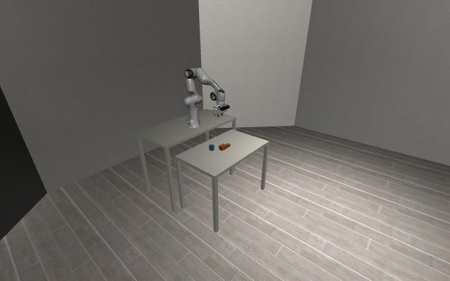
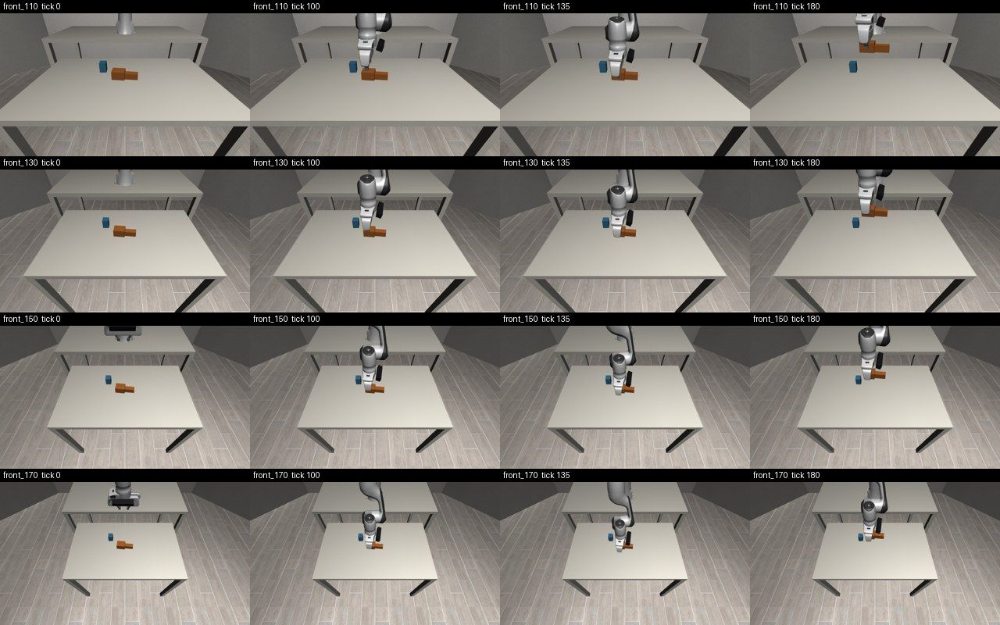
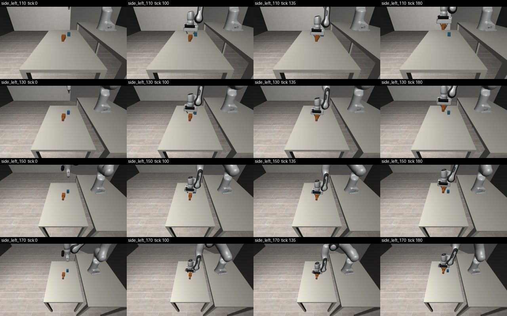
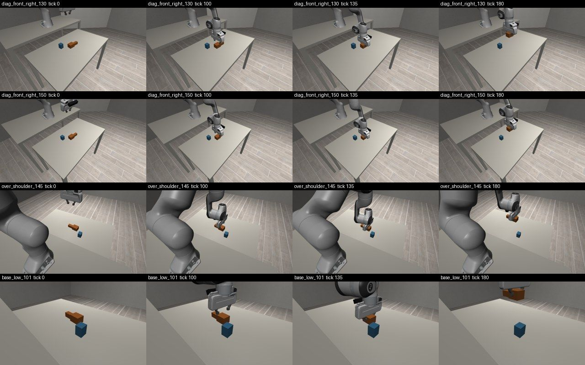
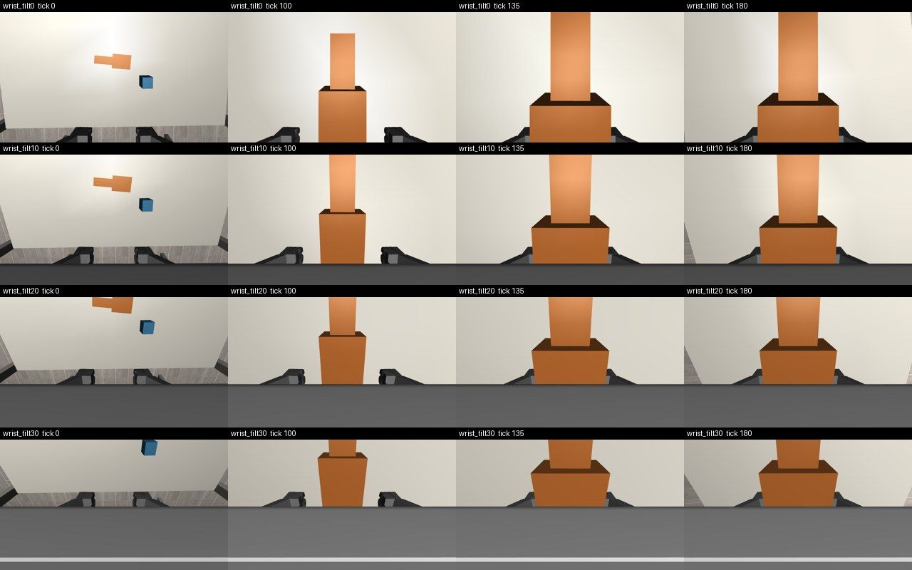

# 实验室场景建模与相机位置研究（2026-11-17）

## 1. 场景

按实验室实测尺寸，在仿真里搭出两张桌子（代码 [robolab/lab_scene.py](../robolab/lab_scene.py)）：

| 项目 | 尺寸 | 来源 |
| --- | --- | --- |
| 机械臂桌 | 高 89 cm，长 120 cm，宽 60 cm | 用户实测；宽度未量，暂按 60 cm |
| 机械臂位置 | 底座中心离一条短边 60 cm（即左右居中），离面向物体桌的长边 21 cm | 用户实测 |
| 物体桌 | 高 74 cm，长 100 cm，宽 60 cm | 用户实测 |
| 摆放 | 物体桌的长边紧贴机械臂桌的前长边，两桌中心对齐 | 用户确认 |
| 颜色 | 白色略偏米白（RGB 0.93, 0.91, 0.86） | 用户描述 |

- 物体桌面比机械臂底座低 15 cm，物体桌从机械臂底座前方 21 cm 延伸到 81 cm。
- 机械臂、控制器、物体和接触判定与数据集完全相同，只改了高度和周围的家具。
- 地面和墙面沿用 LIBERO 的贴图，实验室的实际地面没有测量。



## 2. 相机参数（RealSense D455 彩色相机）

| 参数 | 取值 | 说明 |
| --- | --- | --- |
| 传感器 | OV9782，全局快门 | 零售商规格页 |
| 分辨率 | 1280 × 800（16:10） | 零售商规格页 |
| 视场角 | 90° × 65°（±3°） | 多数零售商规格页 |
| 另一说法 | 86° × 57° | 部分规格页；可能是深度相机的数值 |
| 机身 | 124 × 26 × 29 mm | ARK 与零售商一致 |

Intel 官方规格页在研究时无法访问，各家零售商的视场角说法不一致，所以所有结果都按 90°×65°（“标准”）和 86°×57°（“窄”）两种视场角各算一遍。结论在两种视场角下相同。到实验室可以用 `rs-enumerate-devices -c` 读出相机的真实内参来核对。

## 3. 方法

1. **在实验室布局里实际抓取。** 在物体桌上取 5×5 = 25 个位置（离桌边留 10 cm），物体朝向和指定部位轮换，每个位置旁边放一个障碍物。用数据集的规则教师和真实的 OSC 控制器执行，记录每个时刻的完整状态。
2. **对每个候选相机重新渲染。** 所有相机看的是**同一批动作**，只是视角不同，比较是公平的。
3. **用分割图量化可见性。** 对每一帧渲染两次：一次画机械臂，一次不画。两次中“指定部位”的像素数之比，就是这个部位没被机械臂挡住的比例。只统计“接近、下降、闭合”三个阶段，因为这是策略决定往哪里抓的时候。
4. **换算到策略实际看到的分辨率。** openpi 会把 1280×800 的图像缩放到 224×140（加黑边补成 224×224），所以物体大小按这个分辨率报告。

复现：

```bash
bash scripts/launch.sh --lab-camera-study --output-dir outputs/lab_camera_study
```

腕部相机的偏移和倾角扫描在 `outputs/lab_camera_study/wrist_offset_study.py`。

## 4. 机械臂能抓到的范围

25 个位置里成功 24 个。物体桌从离桌边 10 cm 到离远边 10 cm、左右 ±40 cm 的范围内基本都能抓。唯一失败的是**远端左角**（离底座 71 cm、偏左 40 cm），手指碰到了桌面。所以扩充数据时，物体摆放范围可以取离底座 30–70 cm、左右 ±40 cm，远角留一点余量。

## 5. 外部相机：放哪里、多高

候选位置（高度都是离地高度；物体桌面 74 cm）：

- **正对面**：物体桌远边外 30 cm，正对机械臂。
- **侧面**：物体桌左侧或右侧边外 30 cm。
- **斜前方**：远边外 20 cm、右侧边外 10 cm。
- **机械臂肩后**：机械臂桌上，底座后方偏右，1.45 m。
- **机械臂下端**：机械臂桌前缘，底座右前方，比机械臂桌高 12 cm。

所有相机都对准物体桌中心。

*表 1　外部相机（标准视场角 90°×65°；只统计成功的 24 次抓取）*

| 相机 | 抓取前平均可见 | 抓取前一半以上可见的时刻 | 闭合时平均可见 | 细端大小（224 分辨率下的像素） |
| --- | ---: | ---: | ---: | ---: |
| 正对面 1.10 m | 0.90 | 95% | 0.63 | 53 |
| **正对面 1.30 m** | **0.85** | **89%** | **0.49** | **44** |
| 正对面 1.50 m | 0.79 | 82% | 0.36 | 33 |
| 正对面 1.70 m | 0.74 | 71% | 0.24 | 23 |
| 左侧 1.10 m | 0.90 | 96% | 0.67 | 33 |
| **左侧 1.30 m** | **0.84** | **90%** | **0.54** | **29** |
| 左侧 1.50 m | 0.82 | 86% | 0.46 | 24 |
| 右侧 1.30 m | 0.82 | 88% | 0.50 | 27 |
| 斜前方 1.30 m | 0.86 | 92% | 0.51 | 30 |
| 机械臂肩后 1.45 m | 0.72 | 71% | 0.33 | 33 |
| 机械臂下端 1.01 m | 0.80 | 89% | 0.52 | 77（但有 4% 的时刻物体出画） |







**读法：**

1. **高度比方向影响大。** 同一方向下，越低越好：机械臂从上方下来，相机越高，越容易被夹爪挡住，物体也越小。但 1.10 m 时相机只比桌面高 36 cm，几乎平视，物体之间、物体和障碍物之间容易互相遮挡（开始时“较小那一段”的最小可见面积在 1.10 m 时最差）。
2. **正对面和侧面的可见性几乎一样**，差别在 0.03 以内。
3. **正对面看到的物体大 50% 左右**（1.30 m 时细端 44 像素，侧面 27–29 像素）。本任务的核心是分辨粗端和细端，这一点很重要。
4. **机械臂肩后不要用**：机械臂自己挡住大部分画面。
5. **机械臂下端**：物体看得最大，但抓取时容易被夹爪挡住，远处的物体还会出画（窄视场角下 21% 的时刻出画）。不建议作为唯一的外部相机。

**推荐：正对面，离地约 1.30 m。** 也就是比物体桌面高约 56 cm，放在物体桌远边外约 30 cm 处，对准桌面中心，向下俯视约 43°。理由：

- 与侧面可见性相同，但物体在图像里大约 1.5 倍，更容易分辨粗端和细端。
- 左右对称：物体放在桌子左边或右边，看起来一样清楚。侧面相机对远离相机那一半桌面的物体看得更小。
- 和 LIBERO 的 agentview 视角一致（也是从机械臂对面斜向下看）。现有数据和 π₀.₅ 的 LIBERO 预训练都是这种视角。

如果实验室条件不方便放在正对面，**左侧 1.30 m** 是几乎同样好的备选。

**一个要注意的问题：** 不管放哪里，在策略实际看到的 224×140 分辨率下，物体都只有几十个像素（细端约 6×7 像素）。可以考虑把相机再往桌子方向挪 10–15 cm，让桌面更多地占满画面。这一点没有在本研究里测试。

## 6. 腕部相机：要不要倾斜、倾多少

D455 机身较大，装在夹爪侧面时，镜头中心会偏离夹爪中轴几厘米（下表的“偏移”）。偏移越大，抓取点在画面里越偏，越可能出画；倾斜镜头可以把它拉回来，但倾得太多，夹爪本身会占掉画面下半部分。

*表 2　腕部相机（“可用”= 指定部位一半以上可见，且中心在画面中间 80% 的范围内）*

| 偏移 | 倾角 | 抓取前可用（标准视场角） | 闭合时可用（标准） | 闭合时可用（窄） | 夹爪占画面 |
| --- | --- | ---: | ---: | ---: | ---: |
| 6 cm | 0° | 93% | 100% | 71% | 3% |
| **6 cm** | **10°** | **94%** | **100%** | **100%** | **18%** |
| 6 cm | 20° | 90% | 86% | 92% | 33% |
| 8 cm | 0° | 75% | 33% | 1% | 0% |
| **8 cm** | **20°** | **95%** | **100%** | **100%** | **18%** |
| 8 cm | 30° | 92% | 100% | 100% | 33% |
| 10 cm | 0° | 57% | 0% | 7% | 0% |
| 10 cm | 20° | 89% | 71% | 71% | 5% |
| **10 cm** | **30°** | **93%** | **100%** | **100%** | **21%** |



**结论：你说的倾斜是对的，而且是必要的。**

- 偏移 8 cm 以上时不倾斜，夹爪闭合的那一刻物体基本不在画面中间（闭合时可用只有 0–33%）。
- 最合适的倾角随偏移变化：**偏移 6 cm 倾 10°，8 cm 倾 20°，10 cm 倾 30°**，在两种视场角下都成立。
- 经验公式：倾角 ≈ arctan(偏移 ÷ 镜头到指尖中心的距离) − 20°。镜头和法兰同高时，这个距离约为 10 cm，公式给出 11°、19°、25°，和实测最好的 10°、20°、30° 接近。偏移大时宁可多倾一点。这样抓取点落在画面偏下的位置，既不出画，夹爪也只占画面的 20% 左右。
- 倾得过多（比如 6 cm 偏移倾 40°）时，夹爪会占掉画面的 60%。

**到实验室要量的两个数：** 支架装好后，镜头中心离夹爪中轴的距离，以及镜头比指尖中心高多少。用上面的公式算出倾角，再用 `wrist_camera_pose` 把同样的参数填进仿真，保证训练数据和真机一致。

## 7. 局限

- 物体只用了默认尺寸的长方体族，没有测试圆柱和椭球；不同形状对可见性的影响应该不大。
- 只考虑了相机的方位和高度，没有优化相机到桌子的水平距离。
- 实验室的光照、地面、背景没有测量，仿真里沿用了 LIBERO 的设置。
- 腕部相机的支架几何是估计的：镜头在法兰同一高度，机身长边沿手指开合方向。
- 机械臂桌宽度按 60 cm 假设；它只影响画面里桌子的样子，不影响结果。

## 8. 下一步

1. 到实验室确认相机实际能装的位置，量出腕部支架的偏移和高度，读出 D455 的真实内参。
2. 把这些数字填进 `LabLayout` 和相机参数，用“只改渲染”的方式核对：仿真画面和真机画面叠在一起，桌边和机械臂轮廓应该对齐。
3. 用这个布局生成新一版数据集（物体摆放范围取第 4 节的结果）。
