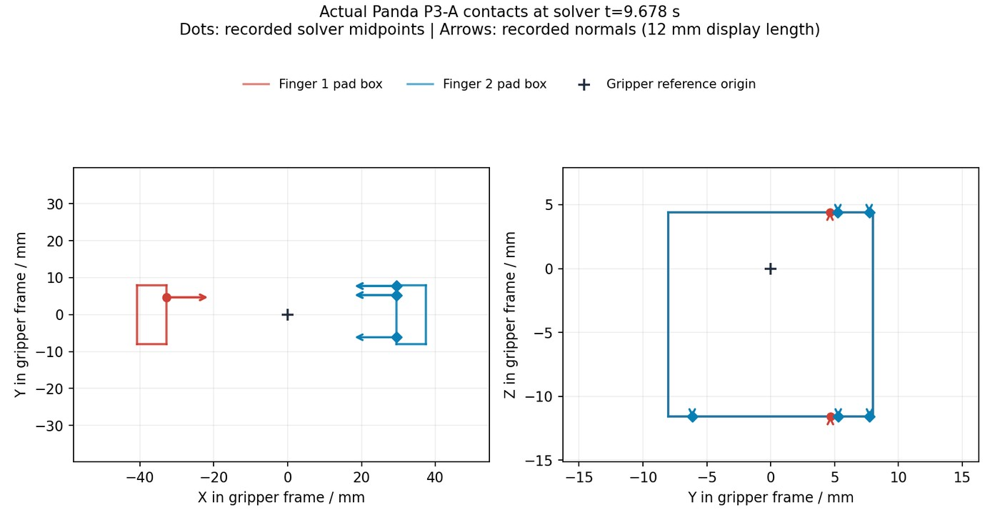
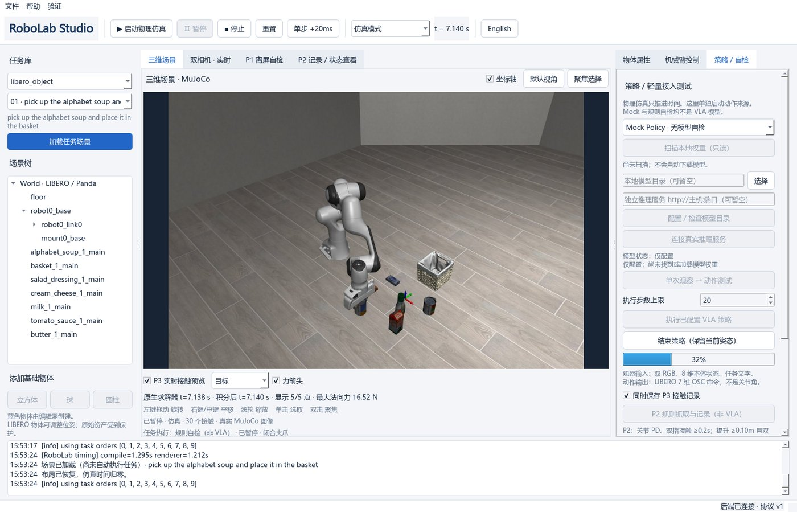
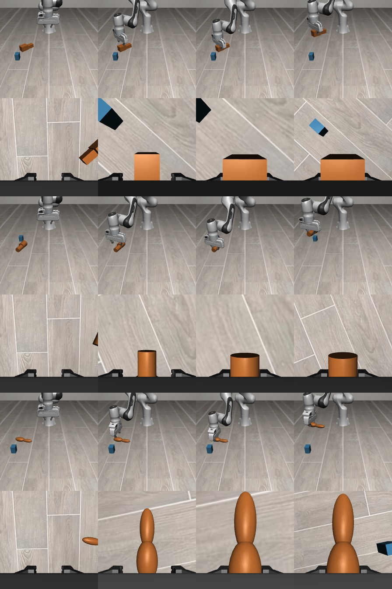
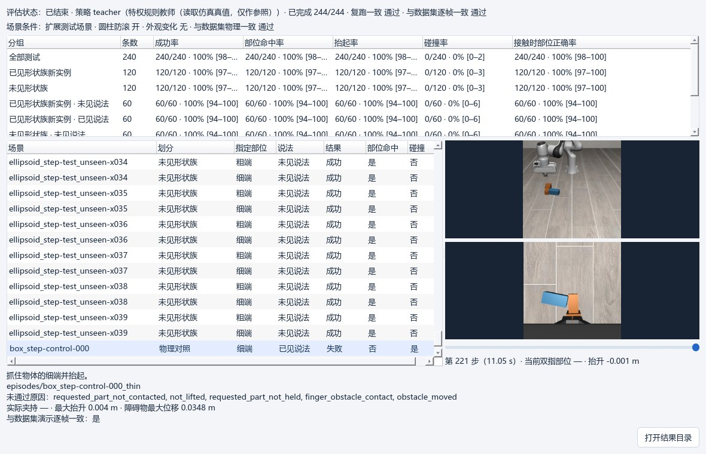
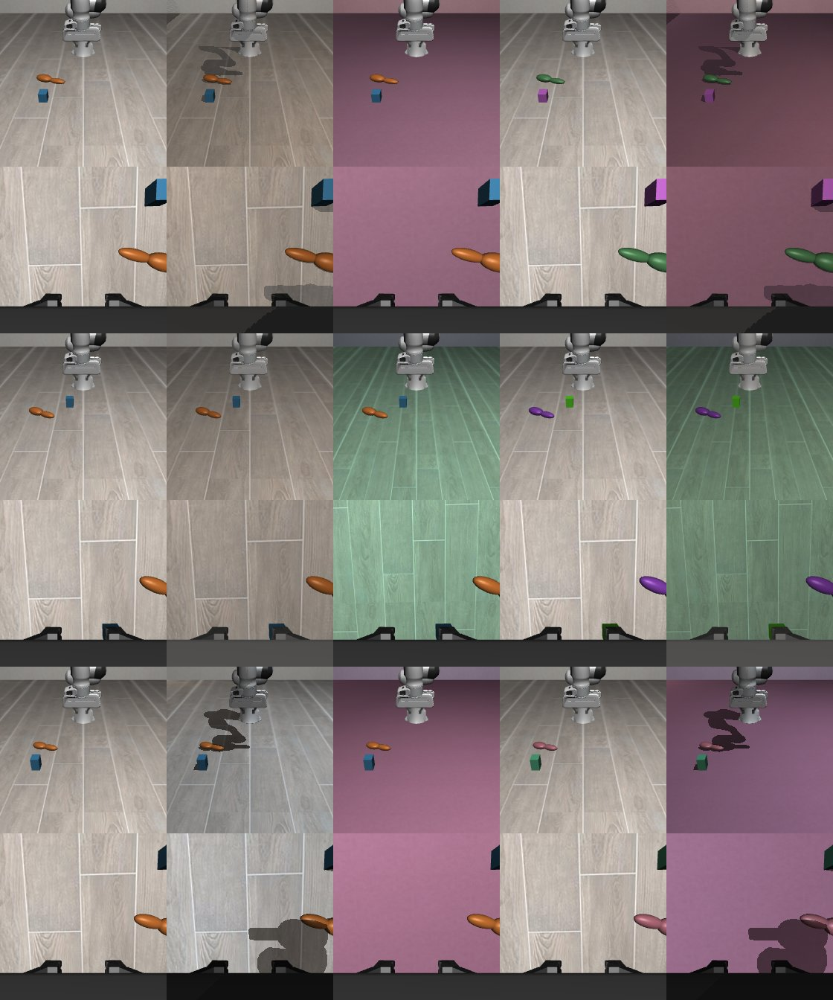
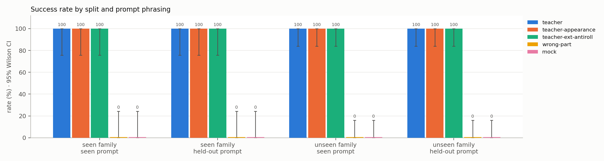

# 面向未见物体零样本 VLA 抓取的夹爪中心接触建模

**Gripper-Centric Contact for Zero-Shot VLA Grasping of Unseen Objects**

**笔记本阶段技术总结与实验室阶段工作计划**

文档日期：2026-11-12　·　代码仓库：<https://github.com/6f6sn7w4pb-ops/robolab-studio>

---

## 写在前面：这份文档是什么

这是一份按论文结构组织、但比论文写得更细、更容易读懂的技术总结。它有两个用途：

1. **记录已经做完的事**。笔记本阶段的全部工作（P0 到 P5-B）都在这里：做了什么、为什么这样做、怎么验证的、发现过什么问题。
2. **说明接下来要做的事**。到实验室之后的工作（L0 到 L5）按步骤写出来，每一步都写明要做什么、依赖什么、做到什么程度算完成。

读这份文档不需要事先了解机器人仿真。第 2 节解释了后面会用到的全部术语；每一节都先用一两句话说明“这一步是干什么的”，再讲细节。

有三点请在阅读全文时始终记住：

- **目前还没有任何学习得到的模型参与实验。** 文中所有的“成功率 100%”，都是一个读取仿真真值的规则程序（下文称“规则教师”）跑出来的。它证明的是数据采集流程和评估框架可靠，**不是**模型的性能。
- **研究的核心方法（在 VLA 里加入夹爪坐标系接触监督）还没有实现。** 笔记本阶段完成的是它需要的全部“地基”：仿真平台、带接触标签的数据集、评估框架。
- **第三部分（实验室阶段）是计划，不是结果。** 其中有关模型训练方式的内容是建议方案，需要根据实验室的实际算力和导师的意见确定。

### 一页读懂

| 问题 | 回答 |
| --- | --- |
| 研究什么 | 给机器人一句话，比如“抓住物体细的一端”，让它在**没见过的物体**上抓对部位。研究的是：训练时额外告诉模型“手指会在夹爪的什么位置碰到物体”，能不能让它抓得更准、碰撞更少 |
| 用什么模型 | 计划以 π₀.₅（openpi）为基线；目前只接好了模型接口，模型本身还没有加载过 |
| 现在有什么 | ① 一个本地仿真工作站 RoboLab Studio；② 一个 200 条示范的数据集，带双相机图像、动作和夹爪坐标系下的接触标签；③ 一套批量闭环评估框架，含 240 条测试场景、统一指标、置信区间和对比报表 |
| 可靠性怎么保证 | 每条数据都精确复执行（关节位置差为 0）；抽样重新采集逐字节一致；评估时策略看到的图像与训练数据逐字节相同；91 项自动测试；每个判定都配有“应该失败”的对照实验 |
| 下一步 | 去实验室：清查设备 → 复现环境 → 跑通 π₀.₅ 推理 → 转换数据并训练基线 → 实现接触监督 → 在同一批测试场景上比较 → 条件允许时上真机 |

---

## 目录

**第一部分　研究问题与总体设计**
1. 研究背景与问题
2. 预备知识：读懂本文需要的术语
3. 系统总体设计

**第二部分　已完成的工作（笔记本阶段）**

4. P0–P1：环境核查与双相机渲染
5. P2：不依赖模型的抓取闭环
6. P3：指尖接触的采样、坐标转换与记录
7. P4：按语言指定部位的抓取任务与数据集
8. P5：批量闭环评估框架
9. P5-B：加强实验条件与对比报表
10. 质量保证：怎样确认这些结果可信
11. 开发中发现的问题与教训
12. 成果汇总、与原始需求的对照、当前局限

**第三部分　实验室阶段工作计划**

13. 总览
14. L0：设备清查
15. L1：复现笔记本环境
16. L2：模型检查点与真实推理
17. L3：数据扩充、基线训练与接触监督
18. L4：未见物体评估与消融实验
19. L5：真实机器人实验（拓展目标）
20. 风险与备选方案
21. 建议的执行顺序与完成标志
22. 论文章节与现有材料的对应
23. 结论

**附录**　A 命令速查　B 数据与结果文件速查　C 关键数字一览　D 仓库状态　E 参考链接

---

# 第一部分　研究问题与总体设计

## 1. 研究背景与问题

### 1.1 一个具体的例子

桌上放着一根一头粗、一头细的短棒，旁边有一个小盒子挡着。我们对机器人说：“抓住物体细的一端，把它提起来。”

人做这件事毫不费力，但机器人要连续做对四件事：

1. **听懂**：指令里的“细的一端”指的是物体的哪个部位。
2. **看见**：在相机画面里找到这个部位。物体可以朝任意方向摆放，粗端可能在左也可能在右。
3. **抓准**：把夹爪送到这个部位上，两根手指正好夹住它，而不是夹到另一端或者夹在中间。
4. **不碰别的**：整个过程中手指不能撞到旁边的盒子或者桌面。

更难的是第五件事：**物体是训练时没见过的。** 比如训练时见到的都是由两个方块、或者两个圆柱拼成的棒，测试时换成两个椭球拼成的“葫芦”形。模型不能靠记住见过的物体来完成任务，必须真正理解“粗”和“细”。

### 1.2 VLA 模型与本研究的切入点

**VLA（Vision-Language-Action，视觉—语言—动作）模型**是一类端到端的机器人策略：输入相机图像和一句自然语言指令，直接输出机器人的动作。它通常由一个预训练的视觉语言大模型加上动作输出模块构成，代表性工作有 OpenVLA、π₀、π₀.₅ 等。这类模型的优点是通用，能听懂各种指令；缺点是对“抓在哪里”这种精细的几何问题，并没有专门的约束，全靠从示范数据里隐式学习。

本研究的切入点是给模型增加一种显式的几何监督信号：**接触**。

- 在仿真里，每一次成功的抓取，我们都能精确知道两根手指是在什么位置、朝什么方向、用多大的力碰到物体的。
- 把这些接触信息表达在**夹爪自己的坐标系**里，训练时作为额外的学习目标交给模型。
- 期望的效果是：模型在决定动作时，心里有一个明确的“我的手指要碰到哪里”的目标，从而抓得更准。

### 1.3 研究问题

> **在相同的训练数据预算和统一的评估协议下，在 VLA 策略中引入夹爪坐标系的接触位置监督，能否提高未见刚性物体的“语言指定部位抓取”成功率，并减少碰撞？**

这句话里的每个限定词都对应着实验设计上的要求：

| 限定词       | 含义                            | 在本项目中怎样落实                    |
| --------- | ----------------------------- | ---------------------------- |
| 相同的训练数据预算 | 对比的两个模型用完全相同的示范数据，差别只在有没有接触监督 | 数据集把接触标签和图像、动作存在一起；不用标签时就是基线 |
| 统一的评估协议   | 所有模型在同一批场景、同一套判定标准下评估         | P5 评估框架：固定的测试场景、固定的指标、逐字节可复现 |
| 夹爪坐标系     | 接触位置相对于夹爪来表达，而不是相对于世界或相机      | P3 完成了坐标转换并做了验证              |
| 未见刚性物体    | 测试物体的形状族在训练时完全没有出现过           | 椭球族整族留作测试，并有泄漏审计             |
| 语言指定部位    | 同一个物体、同一个场景，换一句指令就要抓不同的部位     | 每个场景都有“粗端”“细端”两条成对的指令        |
| 减少碰撞      | 除了成功率，还要统计碰撞                  | 每个场景都有障碍物；指标里有独立的碰撞率         |

### 1.4 为什么用“夹爪坐标系”

同一次抓取，可以用不同的坐标系来描述接触点的位置：

- **世界坐标系**：接触点在桌面的哪个位置。物体挪一下，数值就全变了。
- **相机坐标系**：接触点在画面的哪个像素、离相机多远。相机换个位置，数值也全变了。
- **夹爪坐标系**：接触点相对于夹爪本身在哪里。只要是一次正常的两指夹持，接触点就总是落在两个指垫上，法向总是指向夹爪中间。

图 1 是一次真实仿真抓取中记录到的接触点。可以看到，在夹爪坐标系里，接触点整齐地落在左右两个指垫的内表面上，法向相对。**不管物体是什么形状、摆在哪里、相机在哪里，一次好的抓取在夹爪坐标系里看起来都差不多。** 这种与物体无关、与场景无关的规律性，正是它有希望迁移到未见物体上的原因。



*图 1　一次真实仿真抓取中，夹爪坐标系下的接触点（圆点和菱形）和法向（箭头）。左图是俯视，红框和蓝框是两个指垫的碰撞盒；右图是侧视。数据来自 P3-A 的验收运行。*

### 1.5 两阶段的工作方式

研究分两个地点、两个阶段进行，这是由计算资源决定的：

| | 笔记本阶段（已完成） | 实验室阶段（待开展） |
| --- | --- | --- |
| 设备 | RTX 4060 Laptop，8 GB 显存，16 GB 内存，WSL2 Ubuntu 22.04 | 实验室工作站或服务器，配置待清查；Franka Emika Panda（FER）机械臂，两台 RealSense D455 相机 |
| 能做什么 | 物理仿真、数据生成、评估框架、软件开发 | 加载大模型、训练、大规模评估、真机实验 |
| 不做什么 | 不下载大模型权重，不训练 | — |
| 产出 | 平台、数据集、评估框架 | 模型、实验结果、论文结论 |

之所以这样划分，是因为 π₀.₅ 这类模型的训练需要几十 GB 显存，笔记本做不了；而仿真平台、数据格式、评估协议这些工作不需要大模型，完全可以提前做好、做扎实。这样到了实验室，时间可以全部用在模型和实验上。

笔记本阶段给自己定的要求是：**没有模型，也要把除模型之外的一切都准备好，并且每一样都有实测证据。**

---

## 2. 预备知识：读懂本文需要的术语

这一节是一个小词典。已经熟悉机器人仿真的读者可以跳过。

### 2.1 仿真软件

| 术语 | 解释 |
| --- | --- |
| **MuJoCo** | 物理仿真引擎。给定机器人和物体的模型，它计算每一小步时间之后各个物体的位置、速度，以及物体之间的接触力。本项目用 2.3.7 版 |
| **robosuite** | 建立在 MuJoCo 上的机器人仿真框架，提供机械臂模型和控制器。本项目用 1.4.1 版 |
| **LIBERO** | 建立在 robosuite 上的机器人操作基准，提供场景、任务和相机设置。很多 VLA 模型都在它上面评测，所以沿用它的机器人、相机和动作约定，将来接模型最方便 |
| **Panda / FER** | Franka Emika 公司的 7 关节机械臂，带两指平行夹爪。仿真里用的和实验室的真机是同一型号 |
| **MJCF / XML** | MuJoCo 的场景描述文件。本项目每条数据都保存了当时的完整场景文件 |

### 2.2 控制与时间

| 术语 | 解释 |
| --- | --- |
| **关节 PD 控制** | 直接给 7 个关节各指定一个目标角度，由比例—微分控制器驱动过去。早期批次（P2、P3、P4-A/B）用这种方式 |
| **OSC（操作空间控制）** | 不直接指定关节角，而是指定“末端往哪个方向移动多少、转多少”，由控制器换算成关节力矩。LIBERO 和主流 VLA 模型都用这种方式 |
| **7 维 OSC 动作** | `[dx, dy, dz, rx, ry, rz, gripper]`：末端平移增量 3 维、旋转增量 3 维、夹爪开合 1 维。每一维都归一化到 [-1, 1]。**它不是 7 个关节角**，这一点很容易混淆 |
| **tick（控制周期）** | 策略每发出一个动作所对应的时间。本项目的数据集和评估中是 50 毫秒，即每秒 20 次（20 Hz） |
| **子步** | 物理引擎内部的更小时间步。一个 tick 里包含 25 个 2 毫秒的子步 |
| **求解器状态** | 物理引擎在某个子步开始时的完整状态（所有关节的位置、速度）。本项目的图像、接触、状态都明确绑定到某一个求解器状态，保证它们描述的是同一时刻 |

### 2.3 坐标与接触

| 术语 | 解释 |
| --- | --- |
| **世界坐标系** | 固定在仿真场景里的坐标系 |
| **夹爪坐标系** | 固定在夹爪上、随夹爪一起运动的坐标系。本项目用 robosuite 模型里的 `gripper0_grip_site`，原点在两指中间 |
| **指垫（pad）** | 手指内侧用来夹东西的那一小块面。仿真里每根手指有一个专门的指垫碰撞体 |
| **接触** | 物理引擎检测到两个几何体碰在一起时生成的一条记录，包含接触点位置、法向（垂直于接触面的方向）和接触力 |
| **承载接触** | 真正在传递力的接触。物理引擎有时会为“快要碰到”的几何体也生成记录，这些不算 |
| **法向力** | 接触力沿法向的分量，可以理解为“压得有多紧” |

### 2.4 数据与学习

| 术语 | 解释 |
| --- | --- |
| **示范（demonstration）** | 一次完整的任务执行记录，包含每一步的图像、状态和动作，用来训练模型 |
| **规则教师** | 一个用程序写死的抓取策略。它直接读取仿真里物体的真实位置（真值），按固定步骤去抓。它用来生成示范数据，也用来检验评估框架。它不是学习得到的，也不看图像 |
| **特权信息** | 只有仿真里才能得到、真实机器人得不到的信息，比如物体的精确位置。规则教师用了特权信息，所以它的成功率不能和模型比较 |
| **划分（split）** | 把数据分成训练集、验证集、测试集。训练集用来学习，验证集用来挑选模型，测试集只用来报告最终结果 |
| **数据泄漏** | 测试集里的内容不小心出现在训练集里，导致测试结果虚高。本项目有专门的审计程序防止这一点 |
| **未见（unseen）** | 训练时完全没有出现过。本文中专指“形状族未见” |
| **留出说法（held-out phrasing）** | 训练时没有出现过的指令句式。比如训练时只见过“抓住物体的粗端”，测试时用“拿住更粗壮的那一头” |

### 2.5 评估与统计

| 术语 | 解释 |
| --- | --- |
| **开环 / 闭环评估** | 开环是比较模型输出的动作和示范动作有多接近；闭环是让模型真的去控制机器人，看任务有没有完成。闭环才能反映真实能力，本项目做的是闭环评估 |
| **Wilson 置信区间** | 对“成功率”这类比例给出的不确定范围。比如 64 次全部成功，95% Wilson 区间是 94.3%–100%，意思是真实成功率很可能不低于 94.3%。样本越多，区间越窄 |
| **McNemar 检验** | 比较两个模型在**同一批**测试条目上的表现是否有显著差别的统计检验。它只看两个模型结果不同的那些条目 |
| **对照实验** | 故意构造一个“应该失败”的情况，检查判定程序是不是真的会判它失败。用来证明判定程序不是什么都判成功 |
| **逐字节一致** | 两个文件的每一个字节都相同。这是最严格的“可复现”标准 |

---

## 3. 系统总体设计

### 3.1 五条设计原则

整个平台是按下面五条原则搭建的。它们来自项目最初的需求文档，在每一批开发中都被严格执行。

**原则一：物理仿真与 AI 模型分离。** “启动物理仿真”和“执行模型任务”是两个独立的动作。没有模型权重、没有网络时，仿真、控制、接触采集、数据生成都必须能正常运行。

**原则二：模型状态不许含糊。** 界面上把模型状态分成几级：仅有配置、已找到权重文件、模型已加载、真实推理通过。装了源码不等于有权重，有权重不等于加载成功，加载成功不等于推理正确。用于测试接口的假模型（Mock）永远不会被显示成真实模型。

**原则三：证据优先。** 一个功能只有在真实运行并保存了证据之后，才算完成。界面上有了按钮、日志里写了“已加载”、假模型返回了动作，都不能代替真实执行的验收。失败的记录要保留，不能删掉。

**原则四：可复现。** 记录代码版本、依赖版本、随机种子、场景文件、控制参数。数据必须能由“计划 + 代码”重新生成出来。

**原则五：不破坏已有环境。** 不升级、不重装已经能运行的研究环境，不修改第三方库的源码，不自动下载大模型。

### 3.2 架构

平台名为 **RoboLab Studio**，由三层组成（图 2）。

```text
┌──────────────────── 桌面 GUI 进程（PySide6，独立的 .venv） ────────────────────┐
│  三维场景 · 双相机实时画面 · 机械臂控制 · 接触视图 · P4 数据面板 · P5 评估窗口   │
│  中英文一键切换                                                                 │
└───────────────────────────────┬───────────────────────────────────────────────┘
                                │  JSON 行协议 v1（进程间通信）
┌───────────────────────────────┴──────── 仿真后端进程（研究环境的 Python） ─────┐
│  Engine：MuJoCo 2.3.7 + LIBERO / robosuite 的机器人与场景资产                   │
│  物理推进和渲染都在后端主线程                                                   │
│  接触采样 · 规则教师 · OSC 控制器 · 记录与校验                                  │
└───────────────────────────────┬───────────────────────────────────────────────┘
                                │  观测 robolab.observation.v1  →  动作 libero_osc_7d
┌───────────────────────────────┴──────── 策略适配器（可替换） ──────────────────┐
│  Mock（无模型自检）│ OpenVLA-OFT（独立 HTTP 推理服务）│ 将来：π₀.₅ / openpi     │
└───────────────────────────────────────────────────────────────────────────────┘

不经过 GUI 的批处理入口：
  --p4d-dataset 采集数据集    --p4d-export 导出训练视图
  --p5-eval     批量闭环评估  --p5-compare 多次评估对比
```

*图 2　RoboLab Studio 的三层结构。*



*图 3　RoboLab Studio 主窗口。左侧是任务库和场景树，中间是 MuJoCo 三维场景（正在显示实时接触预览），右侧是策略和自检面板。*

这样分层有几个实际的好处：

- **GUI 和仿真分在两个进程**，是因为图形界面库和物理引擎各自需要自己的图形上下文，放在一起容易冲突。分开之后，GUI 崩溃不会丢失仿真数据，仿真出错也不会让界面卡死。
- **GUI 用独立的 Python 环境**，是为了不往已有的研究环境里安装界面库，遵守“不破坏已有环境”的原则。
- **策略适配器是可替换的**，将来换模型时只需要写一个新的适配器，仿真器和界面都不用改。

### 3.3 观测与动作合同

“合同”指的是仿真器和模型之间约定好的数据格式。不管接哪个模型，仿真器给出的观测和接收的动作都是同一种格式，模型专用的转换（比如图像翻转、裁剪）全部放在适配器里。

**观测**（`robolab.observation.v1`）包含：

| 字段 | 内容 |
| --- | --- |
| 两路图像 | 外部相机 `agentview` 和腕部相机 `robot0_eye_in_hand`，各 224×224 的 RGB，图像原点在左上角 |
| 本体状态（8 维） | 末端位置 3 维、末端朝向（轴角）3 维、两个手指关节的位置 2 维 |
| 关节角（7 维） | 7 个手臂关节的实际角度 |
| 相机标定 | 两台相机的内参矩阵 K 和外参（相机在世界中的位姿）。腕部相机的外参每一帧都更新 |
| 指令 | 一句自然语言，中文或英文 |

**动作**（`libero_osc_7d`）就是 2.2 节说的 7 维 OSC 动作。模型一次可以返回一串动作（称为“动作块”），评估框架会逐个执行。

这两路相机对应着实验室的真实硬件：外部相机对应固定在桌边的 D455，腕部相机对应装在机械臂手腕上的 D455。只用 RGB，不用深度。

### 3.4 代码规模

截至本文档日期，仓库里有 133 个受版本管理的文件，Python 代码约 1.38 万行，测试文件 17 个，后端自动测试 91 项。全部代码在 GitHub 上分成 4 个依次叠加的合并请求（PR #1 到 #4），自动检查全部通过，详见附录 D。

---

# 第二部分　已完成的工作（笔记本阶段）

笔记本阶段按依赖顺序分成 P0 到 P5 六个阶段，后一个阶段建立在前一个阶段已经验收的基础上。表 1 是总览，后面各节逐一展开。

*表 1　笔记本阶段各批工作总览*

| 阶段 | 一句话说明 | 主要产出 | 状态 |
| --- | --- | --- | --- |
| P0 | 检查现有环境，不做改动 | 环境核查报告，受保护文件基线 | 已验收 |
| P1 | 让仿真能稳定输出两路相机图像 | 双相机离屏渲染，桌面 GUI | 已验收 |
| P2 | 不用模型，让机械臂真的抓起一个物体 | 规则抓取、三项物理判定、轨迹记录、末端点动、记录浏览 | 已验收 |
| P3 | 把手指和物体的接触读出来，转到夹爪坐标系 | 接触采样器、坐标转换、接触记录文件、实时与历史接触视图 | 已验收 |
| P4 | 设计“按语言指定部位抓取”的任务并生成数据集 | 双部位参数化物体、成对指令、OSC 采集、200 条数据集、HDF5 训练视图 | 已验收 |
| P5 | 搭建批量闭环评估框架 | 评估协议、指标、策略接口、桌面查看 | 已验收 |
| P5-B | 加强实验条件，支持多次评估对比 | 240 条扩展测试场景、圆柱防滚、外观变化、对比报表 | 已验收 |

## 4. P0–P1：环境核查与双相机渲染

**这一步是干什么的：** 确认已有的软件环境到底能不能用，并做出第一个最小的可运行结果：在一个仿真任务里同时拿到外部相机和腕部相机的图像。

### 4.1 P0 环境核查

开工之前先只检查、不改动。核查的结果（表 2）成为后面所有工作的基线。

*表 2　笔记本环境*

| 项目 | 版本或状态 |
| --- | --- |
| 操作系统 | Windows + WSL2 Ubuntu 22.04 |
| 显卡 | NVIDIA RTX 4060 Laptop，8 GB 显存 |
| Python | 3.10.12 |
| MuJoCo / robosuite / LIBERO | 2.3.7 / 1.4.1 / 0.1.0 |
| PyTorch | 2.2.0 + CUDA 12.1 |
| 桌面界面库 | PySide6 6.8.3，装在独立环境里 |
| 仿真画面渲染 | 桌面用 WSLg；批处理用 EGL 离屏渲染，不依赖显示器 |

核查中发现一个遗留问题：OpenVLA-OFT 的代码在导入时会报一个 protobuf 版本不兼容的错误。这个问题**没有修**，原因是修它需要升级已有环境里的包，可能连带破坏已经能用的仿真；而且它只影响加载 OpenVLA-OFT 模型，不影响仿真、数据和评估。它被如实记录下来，留到实验室用新环境解决。

同时给几个关键文件（LIBERO 配置、第三方源码）记录了哈希值。之后每一批开发结束时都重新比对，确认环境没有被意外改动。

### 4.2 P1 双相机离屏渲染

用 LIBERO-Object 的第一个任务（“把字母汤罐头放进篮子”）做最小测试：创建环境、重置、推进若干步、保存两路相机的图片和动图。一条命令就能运行：

```bash
bash scripts/smoke_test_libero.sh
```

这一步确认了几件对后面很重要的事：

- 两路相机 `agentview` 和 `robot0_eye_in_hand` 能在同一个任务里稳定输出。
- 动作是 7 维，控制器是 OSC，不是关节角。
- 离屏渲染可用，批量任务不需要打开窗口。

### 4.3 桌面 GUI

在 P1 的基础上做了原生桌面界面（图 3），功能包括：加载 LIBERO 任务；三维场景的旋转、平移、缩放和点选；编辑物体位姿，添加方块、球、圆柱等基础物体；控制 7 个关节和夹爪；运行、暂停、单步（每步 20 毫秒）、重置；两路相机的实时预览；保存和恢复场景布局。界面支持中英文一键切换，切换时不会重启仿真。

---

## 5. P2：不依赖模型的抓取闭环

**这一步是干什么的：** 在接入任何模型之前，先证明“机械臂在仿真里真的能把东西抓起来”，并且建立一套判断“到底有没有抓起来”的客观标准。

### 5.1 为什么要先做规则抓取

如果直接上模型，一旦抓不起来，分不清是模型的问题、控制器的问题、还是判定程序的问题。先用一个确定性的规则程序把整个链路跑通，后面出了问题才有参照。

规则抓取的做法很直接：读取物体在仿真里的真实位置，用逆运动学算出关节角，按“稳定 → 接近 → 闭合夹爪 → 提升 → 搬运 → 放下”的固定顺序执行。它不看图像，也不理解语言。

### 5.2 三项独立的物理判定

“抓取成功”不能凭画面看着像，必须由物理量判定。P2 定了三项，必须全部满足：

| 判定 | 定义 |
| --- | --- |
| 双指接触 | 两根手指都和目标物体有接触，并且连续保持至少 0.20 秒。手掌碰到不算，碰到别的物体不算 |
| 持续提升 | 物体比初始高度抬高至少 0.10 米，并且在双指接触的状态下连续保持至少 0.50 秒 |
| 官方任务完成 | 把最终状态交给 LIBERO 自带的任务判定程序，由它确认任务完成 |

### 5.3 实测结果

- **可重复性**：同一个初始状态重复运行 3 次，全部通过；三次的最终关节位置完全相同（差为 0）。每次 22 秒仿真时间，记录 1,101 个采样点。物体最大提升约 0.28 米。
- **失败对照**：故意关掉“接近”这一步，让夹爪在够不到物体的地方合上。结果物理上确实没抓住，判定程序也正确地判为失败。这证明判定程序不是什么都判成功。
- **取消**：运行到一半取消，会单独保存一条“已取消”的记录，不会冒充成功。

### 5.4 第二批：末端点动、记录浏览、状态查看

- **末端点动**：在界面上点按钮，让末端沿世界坐标的 X、Y、Z 方向每次移动 1 到 10 毫米。点动和自动任务互斥，不会相互干扰。
- **记录浏览**：在界面里列出所有抓取记录，并区分五种状态：成功、失败、已取消、不完整、损坏。
- **状态查看**：新版记录格式（v2）每一帧都保存完整的场景状态，可以拖动滑块查看任意时刻的画面。旧版记录（v1）没有这些数据，界面会明确提示，只显示结果。
- **更多初始状态**：在 4 个不同的官方初始布局上共运行 5 次，全部通过。

这里特别区分了三个容易混淆的概念：**状态查看**（把保存的状态重新画出来）、**物理重执行**（按保存的动作重新仿真一遍）、**原始成功证据**（当时的判定结果）。P2 的状态查看只是第一种，不会重新仿真，更不会改变原来的判定。

---

## 6. P3：指尖接触的采样、坐标转换与记录

**这一步是干什么的：** 这是与研究题目直接相关的第一块核心功能：把物理引擎里“手指碰到物体”的信息准确地读出来，转换到夹爪坐标系，并可靠地保存和显示。

P3 分三个小批完成：A 批做采样和坐标转换，B 批做持久化记录，C 批做可视化。

### 6.1 从物理引擎里读接触

MuJoCo 每推进一个子步，都会生成一份接触列表，每一条包含：是哪两个几何体碰在一起、接触点的位置、接触面的法向、接触力。但直接用这份列表有几个陷阱，P3-A 逐一做了处理：

**陷阱一：不是所有接触都是我们要的。** 列表里包括机械臂连杆之间的接触、物体和桌面的接触等等。采样器把接触按“谁碰了谁”分成四类：手指—目标物体、手指—环境、手指—干扰物、其他。又把手指上的几何体分成“指垫”和“手指其他部分”。只有“指垫—目标物体”才是正常的夹持接触。

**陷阱二：有记录不等于有力。** 物理引擎会为距离很近但还没真正压上的几何体也生成接触记录。采样器把“约束是否激活”“是否承载”单独标出来，不拿几何距离代替。

**陷阱三：方向约定不统一。** 物理引擎里一条接触的两个几何体谁排前、谁排后是不固定的，法向和力的正负号会跟着变。采样器统一规定：**法向从手指指向物体，力是手指作用在物体上的力**，并对两种排列顺序都做了测试。

**陷阱四：时刻要对齐。** 接触力是物理引擎在“某个子步开始时的状态”上求解出来的。如果把这个力和子步结束后的图像配在一起，时间上就差了一步。采样器明确记录两个时刻：求解器输入时刻和积分之后的时刻，后面所有数据都按前者对齐。

### 6.2 转到夹爪坐标系

设夹爪坐标系在世界中的朝向是旋转矩阵 R、位置是向量 t，世界坐标系下的接触点是 p_w，那么它在夹爪坐标系下的坐标是：

```text
p_g = Rᵀ · (p_w − t)
```

也就是先减去夹爪的位置，再把结果转到夹爪的朝向下。法向和力是方向量，只做旋转、不做平移：

```text
n_g = Rᵀ · n_w        f_g = Rᵀ · f_w
```

这个转换有 7 项单元测试：纯平移、纯旋转、随机刚体变换的往返、法向长度保持为 1、接触轴的正负号、非法输入的拒绝、以及一个“1 千克物体压在指垫上”的小场景（两种几何体排列顺序下，读出的力都应该等于重力）。

### 6.3 A 批的实测验证

| 检查 | 结果 |
| --- | --- |
| 采样是否影响物理 | 同一个抓取任务，开启和关闭采样各跑一次：每一帧的控制命令、关节位置完全相同，最终关节位置差为 0。采样只读不写 |
| 采样数量 | 22 秒的任务产生 1,100 个接触样本，与 1,101 行轨迹一一对应（初始行没有样本） |
| 两根手指 | 两侧指垫都记录到了对目标物体的承载接触 |
| 接触点位置是否合理 | 接触点相对于指垫碰撞盒的最大超出量约 6.6×10⁻⁷ 米，也就是都落在指垫表面上 |
| 力的量级 | 单个接触点的法向力峰值约 20.8 牛和 8.9 牛。这是仿真求解的数值，不是真机测量值 |
| 失败对照 | 故意抓空的那次，550 个样本里没有任何对目标的承载接触，没有误报 |
| 计算开销 | 每个 20 毫秒控制步的处理时间中位数从约 3.8 毫秒增加到约 4.5 毫秒 |

### 6.4 B 批：接触记录文件

接触数据写成独立的“附属文件”，和原来的抓取记录放在一起但互不干扰：

- `p3_contacts.jsonl`：每个采样时刻一行，包含该时刻的全部接触。
- `p3_contact_metadata.json`：记录帧数、时间范围、文件哈希，以及它所属的那条抓取记录的哈希。

设计上有两个要点：

1. **“接触记录是否完整”和“抓取是否成功”是两件独立的事。** 接触文件损坏，不会改变原来抓取记录的成功或失败；反过来也一样。
2. **没有接触的帧写空列表，不会凭空补一个接触点。** 立即取消的任务可以正常保存为 0 帧。

验证时构造了 8 种损坏情况（中断、缺文件、截断、字节被改、关联错误、未知格式、哈希不匹配等），读取程序都能正确识别。1,653 个真实帧全部通过了结构校验。

### 6.5 C 批：接触可视化

- **实时预览**：仿真运行时，在三维场景里画出接触点、法向和可选的力箭头（箭头长度按 3 毫米每牛缩放）。两根手指用不同颜色。
- **历史查看**：打开一条带接触记录的历史数据，拖动滑块查看任意一帧。可以切换到桌面相机、腕部相机，或者一个把夹爪和物体变成半透明的近景视图，方便看到被遮住的接触点。
- **正确的时刻**：画面是用“求解器输入时刻”的状态重新渲染的，和接触力对应的是同一时刻。

在 4 个不同的官方初始布局上运行 5 次，全部通过，每次 1,100 帧接触记录。

### 6.6 P3 的边界

- 接触采样的频率是每个控制周期一次。比这更短的瞬时碰撞可能漏掉。
- 接触点是物理引擎求解用的中点，不是高精度的表面测量。
- 只采集手指的接触。机械臂其他连杆碰到东西，要靠别的办法发现（见 7.9 节）。

---

## 7. P4：按语言指定部位的抓取任务与数据集

**这一步是干什么的：** 设计研究要用的任务，并生成第一版数据集。任务是“同一个物体，按指令抓不同的部位”；数据集里每一帧都有图像、动作和夹爪坐标系下的接触标签。

P4 是笔记本阶段工作量最大的部分，分四个小批（表 3），每一批解决一个具体问题。

*表 3　P4 四个小批的演进*

| 小批 | 解决的问题 | 规模 |
| --- | --- | --- |
| A | 任务本身成不成立：能不能做出“两个部位”的物体，能不能判定“抓的是哪个部位” | 1 种形状，3 条 |
| B | 能不能扩展到多种形状和布局，怎样划分训练和测试 | 3 种形状族，24 条 + 1 条对照 |
| C | 动作格式和模型要用的一致吗：从关节控制换成 OSC | 4 条 |
| D | 规模化：生成正式的第一版数据集，并导出成训练用的格式 | 200 条 + 4 条对照 |

### 7.1 双部位物体

物体是一根由两段首尾相连的刚体组成的短棒，一段粗、一段细，颜色相同。两段在物理引擎里是两个独立的碰撞几何体，所以能分辨手指碰到的是哪一段。

根据每一段的形状，物体分成三个**形状族**（图 4）：

| 形状族 | 两段的形状 | 用途 |
| --- | --- | --- |
| 长方体族 | 两个长方体 | 训练、验证、测试 |
| 圆柱族 | 两个横放的圆柱 | 训练、验证、测试 |
| 椭球族 | 两个椭球，像一个葫芦 | **只用于测试**，训练时完全不出现 |

每一段长 6.4 到 8.6 厘米；粗端宽 4.8 到 6.2 厘米，细端至少比粗端窄 1.4 厘米。这些尺寸是按 Panda 夹爪的张开范围选的，保证两端都抓得住。

两段颜色相同是有意的：模型不能靠颜色区分哪一端是粗的，只能靠形状。



*图 4　数据集里三个形状族的示范。每一行是一条示范的四个时刻（开始、接近、夹住、抬起），每个时刻上方是外部相机画面，下方是腕部相机画面。第一行：长方体族，抓粗端；第二行：圆柱族，抓细端；第三行：椭球族（未见测试），抓粗端。蓝色小盒是障碍物。*

### 7.2 成对的语言指令

每个场景都生成**两条**示范：一条指令是抓粗端，一条是抓细端。两条示范的物体、位置、障碍物、初始状态完全相同，只有指令里的部位词不同。

这种成对设计很关键。如果每个场景只有一条指令，模型可能学到“看到这种布局就这样抓”，完全不用理解语言。成对之后，同一幅画面对应两种不同的正确动作，模型必须读懂指令才能做对。

指令有中英文两个版本。句式分成两组：

- **已见说法**（每个部位 3 种）：比如“抓住物体的粗端并抬起”“握住粗的那一端，把物体抬起来”。训练集和验证集只用这一组。
- **留出说法**（每个部位 2 种）：比如“捏住较宽的一端，把物体抬起来”“拿住更粗壮的那一头，把物体举起来”。只在测试集里出现，用来考察模型对没见过的句式的理解。

### 7.3 怎样判定“抓对了部位”

判定完全基于物理证据，由程序里的 `PartEvidence` 完成：

| 判定 | 定义 |
| --- | --- |
| 部位命中 | 两个指垫**都只**和指定的那一段有承载接触，单点法向力不低于 0.2 牛，连续保持至少 0.20 秒 |
| 抬起 | 两个指垫都承载着物体，物体抬高至少 0.10 米，连续保持至少 1 秒 |
| 成功 | 指定部位在被夹持的状态下满足“抬起”的条件，并且手指没有碰到环境或障碍物 |

为了证明这个判定能区分“抓起来了但部位错了”，A 批做了一个专门的对照：指令说抓粗端，但让规则教师故意去抓细端。结果物体确实被抬起了 16.7 厘米，但判定为**失败**。

### 7.4 规则教师

示范由规则教师生成。它读取指定部位在仿真里的中心位置和物体的朝向，按“稳定 → 接近 → 下降 → 闭合 → 抬起 → 保持”六个阶段执行，全程 11.1 秒（222 个控制周期）。

再强调一次：规则教师用了仿真真值，它的成功只说明“这些场景在物理上是可以抓的、采集流程是通的”，不代表任何模型的能力。

### 7.5 A 批：图像、接触与标定的同步

A 批建立了数据同步的基本做法：每一对图像都是用“求解器输入时刻”的状态重新渲染的，和同一时刻的接触样本共用一个序号和时间戳。每一帧还保存两台相机的内参和外参。

验证方式是把保存的图像和用同一状态重新渲染的图像逐像素比较，结果完全一致。另外在场景里放了一个标记点，用保存的相机参数把它投影到图像上，和实际渲染出的位置比较，偏差约 0.07 像素。这说明保存的相机参数是准确的，将来的几何模块可以直接使用。

### 7.6 B 批：多种形状与划分

B 批把物体扩展到三个形状族，每族 4 个场景，共 24 条，全部通过；另加 1 条“障碍物挡在夹爪路径上”的对照，按预期失败（记录到 124 帧手指与障碍的接触，物体没有被抬起）。

这一批第一次建立了“按形状族留出”的划分方式和自动审计，并人为构造了三种错误的划分（把同一场景的两条拆到不同的集合、测试形状族混入训练集、留出说法混入训练集），确认审计程序都会拒绝。

B 批还留下一个重要的认识：这时的执行方式还是关节 PD 控制，数据里的“动作”是事后从末端运动量出来的，**不是**控制器真正接收的命令。用这样的数据训练模型，再让模型的输出去驱动 OSC 控制器，两边对不上。所以在扩大规模之前，必须先把执行方式换成真正的 OSC。

### 7.7 C 批：换成真正的 OSC 控制

C 批在合成场景上装配了 robosuite 原版的 Panda 机械臂和 `OSC_POSE` 控制器，和 LIBERO 用的是同一套代码。规则教师不再输出关节角，而是每个周期输出一个 7 维 OSC 动作。

动作的具体含义：

| 分量 | 含义 | 缩放 |
| --- | --- | --- |
| dx, dy, dz | 末端平移增量 | 归一化值 1 对应 0.05 米 |
| rx, ry, rz | 末端旋转增量（旋转向量） | 归一化值 1 对应 0.5 弧度 |
| gripper | 夹爪 | −1 张开，+1 闭合 |

数据里保存的是**实际发送给控制器的值**。这一点通过“精确复执行”来验证：重新加载同样的场景和初始状态，换一个全新的控制器，把文件里的动作一个一个发进去，然后逐周期比较关节位置、关节速度、控制器目标和原始接触。结果完全相同，关节位置最大差为 0。

这意味着数据集里的每一条示范，都可以由它自己保存的动作序列百分之百地重现。

### 7.8 时间对齐

数据集里每个控制周期保存一组“观测—动作”对，时间关系如下：

```text
第 i 个周期开始（t = 0.05 × i 秒）
   │  此刻的求解器状态  →  渲染两路图像、读取本体状态、读取接触   ＝ 观测 o_i
   │  规则教师（或将来的模型）给出动作 a_i
   ▼  执行 a_i：推进 25 个 2 毫秒子步
第 i+1 个周期开始
   │  观测 o_{i+1} ……
```

也就是说，o_i 是动作 a_i 发出那一刻机器人“看到”的东西。这和模型在闭环运行时的情形完全一致，所以用这份数据训练出的模型，在评估时面对的输入不会有时间上的错位。

### 7.9 D 批：第一版数据集

#### 7.9.1 场景计划

数据集的每个场景由一份“计划”决定：物体各段的尺寸、物体的位置和朝向、障碍物的大小和位置、用哪一句指令。计划有两个特点。

**确定性。** 每个随机量都由 `SHA256(种子 | 场景名 | 字段名 | 尝试次数)` 算出，不依赖任何库的随机数生成器。只要代码和种子相同，换一台机器、换一个库版本，生成的计划完全相同。整份计划有一个哈希值，评估时会核对。

**朝向覆盖整圈。** 这是 D 批修正的一个设计问题。B 批的场景里，物体的偏航角只有 ±12 度，粗端总在画面的同一侧。用这样的数据训练，模型很可能学到“画面左边就是粗端”这种**位置捷径**，根本不去看形状，“按语言指定部位”就失去了意义。D 批让物体朝向在 0 到 360 度内均匀分布，并检查训练集里每个部位出现的方向都覆盖全部四个象限（各 30 条，完全均衡）。

障碍物用“拒绝采样”放置：随机选一个位置，如果它落在物体周围 3 厘米以内，或者落在手指合拢时会扫过的区域里，就重新选。这样保证正常示范里障碍物不挡路，但又离得足够近（10 到 22 厘米），不小心的策略会碰到它。

#### 7.9.2 划分

*表 4　第一版数据集的划分*

| 划分 | 形状族 | 场景数 | 示范数 | 用途 |
| --- | --- | ---: | ---: | --- |
| train | 长方体、圆柱 | 60 | 120 | 训练 |
| validation | 长方体、圆柱 | 8 | 16 | 挑选模型 |
| test_instance | 长方体、圆柱 | 12 | 24 | 测试：已见形状族的新实例 |
| test_unseen | 椭球 | 20 | 40 | 测试：未见形状族 |
| control | 三族都有 | 4 | 4 | 阻挡对照，预期失败，不属于任何划分 |

两个测试划分里，各有一半场景使用留出说法。这样测试集构成一个 2×2 的设计（表 5），可以把“形状没见过”和“说法没见过”两种泛化分开来看。

*表 5　测试集的 2×2 设计（示范数）*

| | 已见说法 | 留出说法 |
| --- | ---: | ---: |
| 已见形状族（新实例） | 12 | 12 |
| 未见形状族 | 20 | 20 |

#### 7.9.3 泄漏审计

审计程序会拒绝以下任何一种情况：

- 未见形状族出现在训练集、验证集或 test_instance 里；
- 两个场景使用了同一个形状实例，或者完全相同的布局；
- 留出说法出现在训练集或验证集里；
- 同一句指令被用来指两个不同的部位；
- 同一场景的粗端、细端两条被拆开，或者它们的场景不一致；
- 对照条目混进了任何划分。

每一种情况都有对应的单元测试：人为构造这种错误，确认审计确实会报错。

#### 7.9.4 采集与逐条校验

采集由多个进程并行完成，每个进程带一个仿真引擎。每个引擎约占 2.7 GB 内存，笔记本上最多并行 2 个。

每一条采集完成后**立即**校验，包括：

1. 文件哈希；
2. 图像、动作、接触三者的序号和时间是否对齐；
3. 精确复执行（见 7.7 节）；
4. **障碍物是否被碰动**：障碍物相对于它静置之后的位置，位移必须小于 2 毫米。这一项用来发现手臂或手掌碰到障碍物的情况，因为接触采样只看手指；
5. **抓取之前物体是否被扰动**：从静置结束到夹爪开始闭合，物体转动必须小于 1 度、位移必须小于 1 毫米。

采集全部结束后，在每个划分里各抽一条，用一个全新的进程重新采集，然后把新旧两份的所有文件（包括每一张图片）逐字节比较。

#### 7.9.5 第一次采集暴露的问题

第一次正式采集从形式上看是全部通过的：所有条目都完成了校验和精确复执行，对照按预期失败，抽样逐字节一致。但未见族里有 3 条失败。

这 3 条失败没有被当作“教师在新形状上的正常失败”接受下来，而是逐帧追查。追查的结果是：

- 物体从第 75 到 81 帧开始倾斜，最后翻转了 144 到 156 度。整个翻倒过程中它只和地面接触，夹爪这时还在 19 厘米高的地方。**物体是自己滚翻的。**
- 原因是几何上的：一个椭球平放在地上，只有当它的竖直半轴比水平半轴短时才是稳定的。这两个场景里粗端的高宽比是 1.085 和 1.061，相当于把鸡蛋竖着立在桌上，微小的数值误差被不断放大，几秒钟后就倒了。
- 更严重的是，同一场景的另一条示范里，物体翻倒之后恰好又被抓了起来，**被原来的判定算成了成功**。原来的判定只看最后有没有夹住指定部位、有没有抬起，发现不了“抓之前物体已经被动过了”。

修复了三处：

1. 生成器里给椭球加上稳定约束：两段的高宽比都不超过 0.92。
2. 判定里加上 7.9.4 节的第 5 项“抓取前扰动检查”。在作废的数据上验证，它恰好标出了 4 条翻倒的记录（包括那条被误判的“成功”）。
3. 第一批数据整体作废，但保留下来作为证据；用修复后的计划全部重新采集。

这件事的教训在第 11 节还会再讲。

#### 7.9.6 最终结果

*表 6　第一版数据集的验收结果*

| 项目 | 结果 |
| --- | --- |
| 校验与精确复执行 | 204/204 条通过，关节位置最大差为 0 |
| 示范 | 200/200 条成功 |
| 阻挡对照 | 4/4 条按预期失败，手指与障碍的接触分别为 35、56、61、29 帧 |
| 抽样重新采集 | 4/4 条逐字节一致 |
| 跨批次复现 | 与作废的第一次采集相比，场景没有变的 163 条全部逐字节一致，共比较了 72,372 张图片。两次采集是独立运行的 |
| 抬升高度 | 0.1616 到 0.1649 米 |
| 抓取前物体的最大转动 | 0.033 度 |
| 成功示范中障碍物的位移 | 不超过 2×10⁻¹² 米 |
| 动作饱和 | 44,400 个控制周期中，有 2.99% 的周期里手臂分量被截断到 ±1，主要发生在对齐物体朝向的那几步 |
| 采集耗时 | 约 60 分钟（2 个进程，每条中位数 33.5 秒，含精确复执行） |
| 原始数据大小 | 5.1 GB，约每条 25 MB |

### 7.10 训练视图

原始记录是 JSON 行文件加 PNG 图片，便于检查但不便于训练。所以另外导出了一份**训练视图**：每个划分一个 HDF5 文件，布局沿用 LIBERO 和 robomimic 的习惯，只包含成功的示范。

*表 7　训练视图中每条示范的主要内容（T 为帧数，每条 222 帧）*

| 类别 | 字段 | 说明 |
| --- | --- | --- |
| 观测 | 两路图像 (T, 224, 224, 3) | 外部相机和腕部相机 |
| 观测 | 本体状态 (T, 8) | 与 openpi 的 LIBERO 示例相同：末端位置、轴角、两个手指关节 |
| 观测 | 关节角 (T, 7) | |
| 动作 | 动作 (T, 7) | 实际发送的归一化 OSC 动作 |
| 语言 | 中英文指令、部位、说法类别 | 存在每条示范的属性里 |
| **接触标签** | 每根手指是否有接触 (T, 2) | |
| **接触标签** | 接触点位置，夹爪坐标系 (T, 2, 3) | 按法向力加权平均；没有接触时为 NaN，不会凭空补值 |
| **接触标签** | 接触法向，夹爪坐标系 (T, 2, 3) | 从手指指向物体 |
| **接触标签** | 法向力 (T, 2) | |
| **接触标签** | 接触到的部位 (T, 2) | 无、粗端、细端、两段都有 |
| 几何 | 夹爪位姿 (T, 4, 4) | 夹爪坐标系在世界中的位姿 |
| 几何 | 指定部位的中心，夹爪坐标系 (T, 3) | |
| 几何 | 相机内参 K 与逐帧外参 | |
| 其他 | 最近障碍表面的点和距离、物体抬升高度、手指与障碍的接触 | |
| 原始 | 全部原始接触 | 以后要改标签定义时，不用回头解析原始文件 |
| 原始 | 完整的仿真状态 | |

四个文件共 5.98 GB：训练 3.57 GB（26,640 帧）、验证 0.47 GB、test_instance 0.71 GB、test_unseen 1.23 GB。

导出之后，用**另一套独立编写的代码**重新核对了一遍：

- 用另一个图像库重新解码全部 88,800 张图片，与 HDF5 里的数组逐像素比较，完全一致；
- 状态里的位置与记录的夹爪位姿完全相等；从轴角还原出的姿态，与独立运动学计算的结果相差约 1.5×10⁻¹⁵；
- 接触标签用另一套聚合代码从原始接触重新计算，0 处不一致；
- 没有任何一条示范同时出现在两个文件里。

另外导出了一份**归一化统计**（每一维的均值、标准差、最小最大值、1% 和 99% 分位数），只用训练集计算。

### 7.11 两个使用时要注意的细节

**图像方向。** 数据集里的图像是“规范方向”：左上角为原点，和保存的相机参数一致。openpi 的 LIBERO 示例会把图像旋转 180 度，这等价于对规范图像做一次水平翻转。水平翻转会改变像素的几何关系，所以将来的几何模块应当使用规范图像加上保存的相机参数；如果一定要翻转，相机内参也要同步修改。读取程序提供了两种方向的选项。

**轴角的跳变。** 8 维状态里的朝向用轴角表示。夹爪朝下时转角接近 180 度，而物体朝向又分布在整圈，所以轴角的两个分量会在 ±2.2 附近跳变。这是轴角这种表示方式的固有特性，不是数据错误。数据里同时保存了完整的夹爪位姿矩阵，训练时可以换成连续的旋转表示。

### 7.12 P4 的里程碑：M2 数据闭环

D 批开始前，把“数据闭环”这个里程碑（M2）具体化成 7 条可检验的标准：200 条全部校验并精确复执行；划分有记录且无泄漏；阻挡对照在规模化之后仍然失败；能由计划和代码复现；训练视图通过独立校验；失败样本保留并分类；回归测试通过。7 条全部有实测证据，M2 在笔记本端达成。

---

## 8. P5：批量闭环评估框架

**这一步是干什么的：** 有了数据集之后，需要一把“尺子”来量模型。P5 搭建的就是这把尺子：给它任意一个策略，它在固定的一批测试场景上让策略真的去控制机器人，然后统一输出成功率、部位命中率、碰撞率等指标。

评估框架必须在模型到来**之前**就做好并且验证过。否则等模型训练出来，结果不好的时候，分不清是模型不行还是尺子不准。

### 8.1 闭环协议

每一条测试的流程如下（每个周期 50 毫秒）：

1. **生成观测。** 在当前的求解器状态上渲染两路图像、读取 8 维状态，连同指令一起交给策略。
2. **策略给出动作。** 策略返回 1 到 32 个 7 维动作（一个“动作块”）。可以把整块执行完再问下一次，也可以设置每块只执行前几个。
3. **执行。** 用和数据集采集时**同一套代码**执行：同一个 OSC 控制器，每个周期 25 个子步。
4. **判定。** 每个周期都把接触样本送进和数据集**同一个**判定程序。

每条固定运行 222 个周期（11.1 秒），和示范长度相同。成功之后不会提前结束，所以碰撞统计覆盖整条轨迹。

如果策略返回的动作格式不对，或者数值超出了 [-1, 1]，这一条直接记为失败（原因是“策略错误”），**不会**被悄悄裁剪之后继续执行。裁剪会掩盖模型输出尺度不对的问题。

### 8.2 最关键的性质：评估时看到的和训练时一模一样

模型评估里一个常见而隐蔽的问题是：评估时模型看到的图像，和训练数据里的图像有细微差别，比如渲染时机差了一步、图像方向不同、状态的定义不同。这种差别会让模型表现变差，而且很难发现。

P5 在设计上杜绝了这一点：评估时的观测，是用和数据集导出时同一个状态读取程序、在同一个时刻生成的。并且做了直接的验证：让规则教师在评估框架里重新跑一遍数据集里的场景，然后**逐周期**比较四样东西：

- 动作，与原始记录比较；
- 关节位置，与原始记录比较；
- 两路图像，与 HDF5 训练视图比较；
- 8 维状态，与 HDF5 训练视图比较。

68 条（64 条测试加 4 条对照）全部**完全一致**。也就是说，策略在评估时看到的每一个像素、每一个状态数值，都和训练数据逐字节相同。

### 8.3 指标

*表 8　评估指标（指标版本 v2）*

| 指标 | 定义 | 回答的问题 |
| --- | --- | --- |
| 成功 | 指定部位被夹住并抬起；另一个部位没有被这样夹持；手指没有碰到障碍或地面；障碍物位移小于 2 毫米；没有策略或仿真错误 | 任务完成了吗 |
| 部位命中 | 两个指垫同时夹在指定部位上，持续至少 0.2 秒，不要求抬起 | 夹的位置对吗 |
| 错部位 | 另一个部位满足同样的条件 | 是不是夹到另一头去了 |
| 抬起 | 两指夹着物体抬高至少 10 厘米并保持 1 秒，不区分部位 | 物体被拿起来了吗 |
| 碰撞 | 手指与障碍或地面有承载接触，或者障碍物被推动了至少 2 毫米 | 碰到别的东西了吗 |
| 接触时部位正确率 | 在碰到过物体的条目里，只碰了指定部位的比例 | 把“选错部位”和“根本没抓到”分开 |
| 成功用时 | 达成成功条件的时刻 | 有多快 |
| 抓取前扰动（仅诊断） | 手指碰到物体之前，物体转动至少 1 度或移动至少 1 毫米 | 是不是先把物体撞歪了 |

这些指标的组合能把失败的原因分开。举例来说：

- “抬起”高但“部位命中”低 → 模型会抓，但没听懂抓哪里，是语言理解的问题。
- “部位命中”高但“成功”低 → 位置对了但没抓稳，或者碰到了障碍。
- “碰撞”高 → 接近路径不好。

所有比例都附带 95% Wilson 置信区间。结果按划分、形状族、部位、说法类别以及“划分 × 说法”分组给出。

### 8.4 策略接口

评估框架接受三类策略：

| 策略 | 说明 | 用途 |
| --- | --- | --- |
| `teacher` | 规则教师，每个周期从仿真读取部位位置 | 参照上限，并用来检验观测和执行是否与数据集一致 |
| `wrong_part_teacher` | 同一个教师，故意去抓另一个部位 | 证明部位指标能分辨“抬起来了但部位错了” |
| `adapter:<名字>` | 任何已注册的模型适配器，通过观测合同接入；加上 `--endpoint` 可以连接远程推理服务 | 将来的真实模型从这里接入 |

### 8.5 三组验收运行

用三种没有学习成分的策略检验评估框架本身（表 9）。

*表 9　P5 评估框架的验收结果*

| 策略 | 条数 | 成功 | 部位命中 | 抬起 | 碰撞 | 说明了什么 |
| --- | ---: | --- | --- | --- | --- | --- |
| 规则教师 | 64 | 64/64（95% 区间 94.3–100%） | 64/64 | 64/64 | 0/64 | 评估框架能复现数据集的结果；与数据集逐周期完全一致 |
| 规则教师，阻挡对照 | 4 | 0/4 | 0/4 | 0/4 | **4/4** | 碰撞指标确实会触发 |
| 错部位教师 | 64 | 0/64 | **0/64** | **64/64** | 0/64 | 物体全部被抬起，但全部判为失败：部位指标独立于“是否抬起” |
| 假模型（Mock） | 64 | 0/64 | 0/64 | 0/64 | 0/64 | 适配器接口、图像编码、动作块执行全部走通；假模型只会小幅抬手，本来就不该成功 |

每一组都抽 2 条重新运行，结果文件、轨迹和关键帧图片全部逐字节一致。

这三组结果合起来说明：这把尺子**该量出成功的时候量得出成功，该量出失败的时候量得出失败，而且能分清失败的种类。**

### 8.6 工程特性

- **并行与内存保护**：多进程并行；启动前读取可用内存，自动限制进程数，避免把机器内存耗尽。
- **断点续跑**：中断之后可以接着跑，已完成的条目跳过，写到一半的条目移到单独的目录保留。
- **抽样复跑**：每次评估结束后自动抽样重跑并逐字节比较。
- **只用文件重建汇总**：指标定义修改之后，可以直接从保存的轨迹重新计算，不需要重新仿真。
- **关键帧**：每 20 个周期保存一对策略实际看到的图像，用于事后查看失败案例。
- **耗时**：每条约 16 到 22 秒；64 条用 2 个进程约 11 到 13 分钟。

### 8.7 桌面查看

评估结果可以在桌面界面里打开（图 5）：上方是分组的比例和置信区间；左下是逐条结果的列表；右下是所选条目的关键帧，可以拖动滑块回看；底部显示指令、失败原因、实际夹持的部位、抬升高度和障碍物位移。



*图 5　P5 评估结果窗口，显示的是规则教师在 240 条扩展测试场景上的结果。选中的是一条阻挡对照，底部列出了它的失败原因。*

---

## 9. P5-B：加强实验条件与对比报表

**这一步是干什么的：** 在 P5 的基础上补四样东西：更多的测试场景（让置信区间更窄）、修掉圆柱自己滚动的问题、加入外观变化（考察视觉鲁棒性）、以及把多次评估放在一起比较的报表工具。

这四样都**只作用于评估**，数据集没有任何改动。

### 9.1 扩展测试场景

原来的测试集只有 64 条。64 条全部成功时，95% 置信区间的下限是 94.3%；如果成功率在 50% 附近，区间宽度约 ±12%。这意味着两个模型的成功率差 10 个百分点，都不一定能判定为显著。

所以用和数据集相同的生成器，另外生成了 88 个新的测试场景（176 条）：长方体和圆柱各 24 个新实例，椭球 40 个。它们和**整份**数据集计划（包括训练集）一起通过了泄漏审计。

*表 10　扩展后的测试集*

| | 已见说法 | 留出说法 | 合计 |
| --- | ---: | ---: | ---: |
| 已见形状族（新实例） | 60 | 60 | 120 |
| 未见形状族 | 60 | 60 | 120 |
| 合计 | 120 | 120 | 240 |

240 条时，成功率在 50% 附近的置信区间宽度缩小到约 ±6%；每个格子 60 条，约 ±12%。

### 9.2 圆柱自转的根因与防滚

P5 的验收中注意到一个异常：假模型根本没有碰到物体，却有几条被标记为“物体被扰动”。追查发现是圆柱形的物体自己在动。

P5-B 对数据集里全部 40 个圆柱场景做了被动实验：机械臂完全不动，只观察物体，并把转动分解成“绕自身长轴的滚动”和“绕竖直轴的转动”。

*表 11　圆柱被动实验（40 个场景，各 222 个周期）*

| 接触设置 | 滚动超过 1 度的场景数 | 最大滚动 |
| --- | ---: | ---: |
| 原设置（只有滑动摩擦） | 31 | 10.7 度 |
| 加扭转摩擦 | 31 | 10.7 度 |
| 加扭转和滚动摩擦（作用于目标物体的所有接触） | 0 | 0 |
| **只对“目标物体—地面”这一对接触加滚动摩擦（最终方案）** | **0** | **0** |

结论：

- 现象是**绕长轴的缓慢滚动**，在训练集、验证集、测试集里都存在，从第 137 个周期（约 6.9 秒）之后开始。
- 原因是圆柱和地面之间只有滑动摩擦，几乎没有抵抗滚动的力。
- **数据集的示范没有受影响**：规则教师在滚动开始之前就已经夹住了物体，而且每条示范都通过了“抓取前扰动检查”。
- 受影响的是评估：一个动作比较慢的模型，可能要面对一个已经滚开的物体，这对它不公平，也给结果带来噪声。

最终方案只修改“目标物体和地面”这一对接触，给它加上滚动摩擦，其他参数保持物理引擎原来的取值。手指、障碍物和机械臂的接触完全不变，所以抓握本身的物理没有变化。这个选项叫 `--anti-roll`。

### 9.3 外观变化

数据集里所有场景的光照、地面和物体颜色都是同一种。为了考察模型对外观变化的鲁棒性，加入了三组可以任意组合的变化（图 6）：

| 组 | 变化的内容 |
| --- | --- |
| 光照 | 两盏灯的亮度（原值的 0.55 到 1.15 倍）、色温、位置和高度；环境光；是否有阴影 |
| 背景 | 地面在木地板和素色灰泥两种纹理中选一种，再加上不同的色调和铺设密度；墙面色调 |
| 物体颜色 | 目标物体的颜色和障碍物的颜色。目标物体的两段始终同色；两个物体的色相至少相差 60 度，保证分得开 |



*图 6　外观变化示例。每一行是一个场景；五列依次是：标准外观、只变光照、只变背景、只变物体颜色、全部变化。每格上方是外部相机，下方是腕部相机。*

外观变化有一个重要的性质：它**只改渲染，不改物理**。验证方法是让规则教师在外观变化下重跑数据集的场景，结果动作、关节位置和判定与原数据 68/68 完全一致，而图像从第一帧起全部不同。这意味着，将来模型在外观变化下成功率的下降，可以**完全归因于视觉**，不会混进物理上的差别。

### 9.4 对比报表

论文里需要的是“模型 A 和模型 B 在同一批场景上的对比”。对比报表工具读入 2 到 8 次评估的结果，做下面几件事：

1. 找出所有评估都跑过的条目（“共享条目”），在这批条目上重新计算所有比例，保证比较的是同一批场景和指令。
2. 检查各次评估的设置是否一致（数据集版本、时长、语言等），不一致时给出警告。
3. 每两次评估之间做配对比较：统计“两个都成功”“只有 A 成功”“只有 B 成功”“两个都失败”各有多少条，并做 McNemar 精确检验。
4. 输出：一份可以直接放进论文的 Markdown 表格、一份逐条的 CSV（方便另做统计）、两张带置信区间的柱状图（图 7）、以及包含全部数字的 JSON。



*图 7　对比报表自动生成的图：按“形状族 × 说法”分组的成功率，误差线是 95% Wilson 置信区间。图中三种策略都不是学习得到的模型，这张图只用来展示报表的形式。*

### 9.5 P5-B 的验收结果

*表 12　P5-B 验收运行（规则教师）*

| 运行条件 | 条数 | 成功 | 碰撞 | 阻挡对照 | 抽样复跑 | 与数据集比对 |
| --- | ---: | --- | --- | --- | --- | --- |
| 扩展场景 + 防滚 | 240 + 4 | 240/240（95% 区间 98.4–100%） | 0/240 | 4/4 检出 | 2/2 一致 | 55/55 完全一致；13 条圆柱按设计不参与比对 |
| 数据集场景 + 全部外观变化 | 64 + 4 | 64/64 | 0/64 | 4/4 检出 | 2/2 一致 | 物理 68/68 一致；图像全部不同 |

扩展场景里四个“形状族 × 说法”的格子都是 60/60。这说明这 240 个测试场景在物理上都是可以完成的，将来模型的失败不能归咎于场景本身。

---

## 10. 质量保证：怎样确认这些结果可信

前面每一节都提到了验证。这一节把贯穿始终的六种做法集中说明，因为它们是这份工作可信度的来源。

### 10.1 精确复执行

每一条示范采集完成后，都换一个全新的控制器，把保存的动作重新执行一遍，要求每个周期的关节位置、速度、控制器目标和接触完全相同。数据集的 204 条全部通过，关节位置差为 0。这保证了“数据里的动作”和“实际发生的事”是同一回事。

### 10.2 逐字节复现

抽样的条目用全新的进程重新采集或重新评估，然后比较每一个文件的每一个字节，包括每一张图片。这比“结果看起来差不多”严格得多：任何一处不确定性（没有固定的随机数、依赖运行顺序的状态、浮点运算顺序的差别）都会被发现。数据集有 163 条在两次独立的完整采集之间逐字节一致。

### 10.3 独立的第二条代码路径

对重要的数据转换（比如导出训练视图），用另一套独立编写的代码重新算一遍，再比较结果。如果两套代码犯了同样的错，那只能是巧合。训练视图的图像、状态、接触标签都是这样核对的。

### 10.4 对照实验

每一个判定都配有“应该失败”的对照（表 13）。

*表 13　各阶段的对照实验*

| 要证明的事 | 对照的做法 | 结果 |
| --- | --- | --- |
| 抓取判定不是什么都判成功 | 关掉接近步骤，让夹爪抓空 | 判为失败 |
| 接触采样不会凭空生成接触 | 同上，检查接触记录 | 没有对目标的承载接触 |
| 部位判定能区分两端 | 指令要粗端，教师故意抓细端 | 物体被抬起，但判为失败 |
| 碰撞检测有效 | 把障碍物放进夹爪的路径 | 记录到手指与障碍的接触，判为失败 |
| 泄漏审计有效 | 人为构造每一种泄漏 | 全部被拒绝 |
| 记录读取程序能识别损坏 | 构造 8 种损坏的文件 | 全部正确识别 |
| 外观变化不影响物理 | 教师在外观变化下重跑 | 物理完全一致 |

### 10.5 自动测试与回归

- 后端自动测试 91 项，覆盖坐标转换、接触分类、判定边界、场景计划、泄漏审计、指标计算、统计方法、对比报表等。
- 每一批开发结束时，重跑之前各批的关键结果，确认新代码没有改变旧结果。比如 P4-D 完成后，重跑了 P4-C 和 P4-A 的记录，与旧记录逐字节一致。
- 每一批的界面功能都在真实桌面上实际操作验收，包括中英文切换。
- 代码推送到 GitHub 后有自动检查。

### 10.6 保留失败的证据

- 第一次数据集采集作废后，整批数据和分析脚本都保留了下来。
- 每次首轮验收没通过的记录都保留，并在报告里写明原因和修复方式。
- 运行中断时写到一半的文件会移到单独的目录，不会删除，也不会被当成有效数据。

---

## 11. 开发中发现的问题与教训

这一节列出开发过程中遇到的、有代表性的问题。它们大多不是“程序报错”这种显而易见的问题，而是“程序正常运行、结果看起来也对，但其实有隐患”的问题。对后面的实验室阶段，这些经验比功能清单更有用。

**教训一：形式上全部通过，不等于没有问题。**
第一次数据集采集，所有自动校验都通过了。只是因为没有放过 3 条“看起来合理”的失败，才发现了椭球自己滚翻的问题，以及一条被误判为成功的示范（7.9.5 节）。如果当时接受了那批数据，训练集里就会混进“物体先自己翻倒，再被碰巧抓起来”的示范。
→ **做法：对每一个失败和每一个异常数值都追查到根因，而不是找一个说得通的解释就停下。**

**教训二：数据里的“捷径”比噪声更危险。**
早期场景里物体的朝向范围很小，粗端总在画面同一侧（7.9.1 节）。数据本身没有任何错误，但模型可以完全不看形状就把训练集做对。这种问题在训练时不会有任何征兆，只会在测试时表现为“泛化不好”，而且很难想到是数据的原因。
→ **做法：设计数据时主动问“模型有没有可能不理解任务也能做对”，并用统计（比如方向覆盖）来检查。**

**教训三：记录“发生了什么”和记录“命令是什么”是两回事。**
P4-B 的动作是从末端的实际运动量出来的，不是控制器收到的命令（7.6 节）。两者数值上接近，但用前者训练的模型去驱动控制器，会有系统性的偏差。
→ **做法：训练数据里的动作必须是实际发出的命令，并用精确复执行来证明。**

**教训四：指标的“基准”要选对。**
障碍物位移最初是从初始位置算起的。但障碍物在仿真开始时会从略高于地面的位置落下约 1.1 毫米，这个下落被算进了“被推动的距离”，使得正常示范的数值离 2 毫米的阈值很近。改成从静置之后的位置算起，问题消失。
→ **做法：阈值附近的数值要搞清楚它的来源。**

**教训五：采样时刻的边界。**
接触是在每个周期开始时采样的，而手指可能在上一个周期的中间就已经碰到了物体。最初“抓取前扰动”的时间窗口算到了“第一次采样到接触”的那个周期，结果把手指刚碰到物体时引起的微小位移算成了“抓取前的扰动”。窗口往前移一个周期后解决。
→ **做法：凡是涉及“之前”“之后”的判定，都要想清楚采样的时刻。**

**教训六：一个看似无害的诊断数值，背后可能是系统性的现象。**
假模型没有碰物体，却有 8 条被标记为“扰动”。一开始记录为“4 个测试场景的物体会自己转”，后来系统地检查才发现 40 个圆柱场景里有 31 个都会滚，包括训练集（9.2 节）。
→ **做法：发现异常时，把检查范围扩大到所有同类场景，而不是只看出现异常的那几个。**

**教训七：独立检查的容差和精确比较要分开。**
换成 OSC 之后，一项独立的旋转检查没有通过，差了约 10⁻⁸。原因是 robosuite 内部用 32 位浮点数做了一次转换。处理方式是把这一项独立检查的容差放宽到 10⁻⁷，但精确复执行的比较**没有**放宽，仍然要求完全相等。
→ **做法：不能因为一处有合理的浮点误差，就把所有比较都改成近似相等。**

**教训八：本地通过不等于别处也通过。**
P5 的代码里有一处调用了 MuJoCo 的函数。本地环境装了 MuJoCo，测试全部通过；但 GitHub 上的自动检查只装了 NumPy，测试直接报错。这个问题在提交后才被发现。修复方式是用 NumPy 实现同样的公式，并验证与 MuJoCo 的结果逐位相同。
→ **做法：推送之后要确认自动检查的结果；到了实验室的新环境，也要先跑一遍全部测试。**

**教训九：调参要看图。**
外观变化最初让灯对准工作区，结果画面大面积过曝；纹理候选里有一张迷彩一样的图，上面的橙色块和目标物体很像（9.3 节）。这两个问题从数值上看不出来，只有把图渲染出来看才发现。
→ **做法：凡是影响图像的改动，都要实际渲染出来检查。**

---

## 12. 成果汇总、与原始需求的对照、当前局限

### 12.1 关键数字

*表 14　笔记本阶段的关键数字*

| 类别 | 数字 |
| --- | --- |
| 代码 | 133 个文件，约 1.38 万行 Python，91 项后端自动测试，4 个合并请求 |
| 数据集 | 100 个场景，200 条示范，4 条对照；3 个形状族；44,400 个“观测—动作”对；88,800 张图像 |
| 数据集划分 | 训练 120 / 验证 16 / 已见族测试 24 / 未见族测试 40 |
| 数据集大小 | 原始 5.1 GB；训练视图 5.98 GB |
| 数据校验 | 204/204 条精确复执行，关节位置差 0；163 条跨批次逐字节一致 |
| 评估场景 | 基本 64 条；扩展 240 条（2×2 设计，每格 60 条） |
| 评估验证 | 观测与训练数据 68/68 逐周期一致；规则教师 240/240；错部位教师 0/64；阻挡对照 4/4 |
| 评估耗时 | 240 条约 34 分钟（笔记本，2 个进程） |

### 12.2 与原始需求的对照

项目开始时的需求文档给笔记本阶段定了 5 条“完成定义”。表 15 逐条对照。

*表 15　笔记本阶段完成定义的对照*

| 完成定义 | 状态 | 对应的工作 |
| --- | --- | --- |
| 双 RGB 相机可稳定输出；物理仿真能够独立启动 | 达成 | P1；每条数据和每次评估都依赖它 |
| 不加载大模型也能执行并评估脚本化抓取 | 达成 | P2 规则抓取；P4 规则教师；P5 评估 |
| 指尖接触与夹爪坐标可读取、可视化、可保存 | 达成 | P3 的 A、B、C 三批 |
| 参数化场景可生成小规模数据；训练/测试划分有记录 | 达成并超出 | P4-D：200 条，带泄漏审计和训练视图 |
| 具备可扩展的策略接口与可迁移的代码/配置/测试 | 达成 | 策略适配器；路径全部可配置；代码在 GitHub |

需求文档里原本没有要求、但实际完成了的有：批量闭环评估框架及其验证（P5）、扩展测试集、外观变化、防滚、对比报表（P5-B）。

### 12.3 当前局限

以下各条都是如实的限制，写论文时需要说明，其中一部分是实验室阶段要解决的。

**关于研究结论**

- **没有任何模型的结果。** 研究问题（接触监督是否有帮助）目前没有答案。
- 接触监督的方法本身还没有实现，只准备好了它需要的标签。

**关于数据**

- 示范全部来自同一个规则教师，动作风格单一：固定的接近路径、固定的机械臂初始姿态、固定的节奏。真人示范或更多样的教师会让数据更丰富。
- 训练集只有 120 条。对于微调一个大模型来说很可能偏少，实验室阶段需要扩充。
- 物体只有三个形状族的双段刚体；每个场景一个目标、一个障碍物；物体直接放在地面上，没有桌子和其他杂物。
- 数据集的图像没有外观变化。
- 椭球族因为稳定性约束，细端的高度范围比其他两族窄。这是未见族本身的分布差异，需要说明。
- 数据集采集时没有开启防滚。示范不受影响，但严格来说，训练数据和开启防滚的评估在圆柱与地面的接触模型上有差别。如果扩充数据集，建议采集时也开启。

**关于接触与碰撞**

- 只采集手指的接触。机械臂其他连杆的碰撞只能通过物体和障碍物的位移间接发现。
- 接触每个周期采样一次，更短的瞬时碰撞可能漏掉。
- 接触点和力是仿真求解的数值，与真实世界会有差别。

**关于评估**

- 外观变化只包括光照和配色，不包括相机位置的变化和更复杂的纹理。
- 扩展测试场景没有录制示范，只能对数据集里原有的条目做逐帧比对。

**关于工程**

- 没有写出 LeRobot 格式（笔记本环境里没有这个库，按原则不安装）。
- OpenVLA-OFT 的导入错误没有修。
- 全新机器上的安装流程没有验收过；不同机器之间能否逐字节复现也没有验证过。
- 没有连接过真实的机器人和相机。

---

# 第三部分　实验室阶段工作计划

> **阅读提示：** 这一部分是计划。其中涉及 openpi 的具体脚本名、配置名和显存需求，来自其公开仓库的说明，**到实验室后要以实际安装的版本为准**。第 17.4 节的接触监督方法是建议方案，需要与导师讨论后确定。

## 13. 总览

### 13.1 要回答的问题和要走的路

实验室阶段的最终目标，是回答 1.3 节的研究问题。为此需要得到至少两个模型在同一批测试场景上的结果：

- **基线**：π₀.₅ 在我们的数据上微调，不使用接触标签。
- **本文方法**：同样的模型、同样的数据、同样的训练设置，只是多了夹爪坐标系接触监督。

然后比较两者的成功率、部位命中率和碰撞率。

走到这一步需要六个阶段，前一个是后一个的前提：

```text
L0 设备清查 ──► L1 复现环境 ──► L2 跑通模型推理 ──► L3 数据与训练 ──► L4 评估与消融
                                                                            │
                                                                            ▼
                                                                  L5 真机实验（拓展）
```

### 13.2 哪些已经准备好，哪些还要做

*表 16　实验室阶段所需条件的准备情况*

| 需要的东西 | 状态 | 说明 |
| --- | --- | --- |
| 仿真平台 | 已就绪 | 代码在 GitHub，路径可配置 |
| 训练数据第一版 | 已就绪，需转换格式 | HDF5 训练视图；要转成 LeRobot 格式 |
| 接触标签 | 已就绪 | 在训练视图里，夹爪坐标系 |
| 相机标定数据 | 已就绪 | 每帧的内参和外参 |
| 评估框架 | 已就绪 | 240 条测试场景，指标、统计、报表齐全 |
| 模型接入口 | 接口已就绪，适配器待写 | 需要写一个把观测合同转成 π₀.₅ 输入的桥接服务 |
| 实验室设备信息 | **未知** | L0 要解决 |
| π₀.₅ 的运行环境和权重 | 未准备 | L2 |
| 更大的训练集 | 生成器已就绪，未生成 | L3，视基线结果决定 |
| 基线模型 | 未训练 | L3 |
| 接触监督的实现 | 未实现 | L3，本研究的核心 |
| 真机接口 | 未实现 | L5 |

### 13.3 去实验室之前，现在就可以做的准备

1. **合并代码。** 把 GitHub 上的 4 个合并请求按 #1 → #2 → #3 → #4 的顺序合并进主分支，并打一个版本标签（比如“笔记本阶段完成”）。以后实验室里的一切结果都记录它所基于的版本。
2. **备份数据。** 数据集（约 11 GB）和所有验收证据都在笔记本的 `outputs/` 目录里，**不在 GitHub 上**。数据集本身可以在实验室重新生成，并用仓库里的指纹核对（见 15.3 节），所以不必带过去；但在实验室核对通过之前，不要删除笔记本上的这一份，万一不一致还要用它查原因。
3. **准备好 L0 的清单。** 把第 14 节的表格打印或存在手机里，到了实验室逐项填写。
4. **向导师或实验室管理员确认**：能用哪台机器、显卡型号和显存、能否联网下载模型、机械臂和相机当前是否可用、有没有现成的控制程序。

---

## 14. L0：设备清查

**目的：** 搞清楚实验室实际有什么。后面的所有选择（用哪种微调方式、能训练多大的批量、要不要量化）都取决于这一步，所以不能凭猜测。

### 14.1 要收集的信息

在实验室的机器上运行以下命令并保存输出：

```bash
nvidia-smi
```

```bash
free -h && df -h
```

```bash
lsb_release -a && uname -r
```

```bash
python3 --version && docker --version
```

*表 17　L0 设备清查表（到实验室后填写）*

| 类别 | 项目 | 记录 |
| --- | --- | --- |
| 计算 | 显卡型号、数量、单卡显存 | |
| 计算 | 内存、可用磁盘空间 | |
| 计算 | 操作系统版本、显卡驱动版本、CUDA 版本 | |
| 计算 | 能否使用 Docker；有没有管理员权限 | |
| 计算 | 能否访问外网（下载模型权重需要）；有没有代理 | |
| 计算 | 是不是多人共用；有没有任务排队系统 | |
| 机械臂 | 型号（预期是 Franka Emika Panda，即 FER）、控制器固件版本 | |
| 机械臂 | 现有的控制方式：libfranka、franka_ros、还是别的；版本 | |
| 夹爪 | 是不是原装 Franka Hand；指尖有没有改装；开合范围 | |
| 相机 | 两台 RealSense D455 的序列号、固件版本、安装位置 | |
| 相机 | 支持的 RGB 分辨率和帧率；有没有已有的标定结果 | |
| 安全 | 急停、工作空间限制、是否需要有人在场 | |

### 14.2 根据显存做决定

openpi 仓库的说明里给出了大致的显存需求（**以实验室安装的版本为准**）：只做推理约需 8 GB 以上；用 LoRA 方式微调约需 22.5 GB 以上；全量微调约需 70 GB 以上。据此可以预先想好几种情况：

*表 18　不同显存条件下的方案*

| 实验室单卡显存 | 可行的方案 |
| --- | --- |
| 70 GB 以上（如 A100 80G、H100） | 全量微调和 LoRA 都可以；优先全量微调，结果更有说服力 |
| 24 到 48 GB（如 RTX 3090/4090、A6000） | 用 LoRA 微调；推理没有问题。注意 openpi 自带的 LoRA 配置是给 π₀ 的，π₀.₅ 的 LIBERO 配置是全量微调（批量 256）；π₀.₅ 的 LoRA 配置要参照 π₀ 的低显存配置自己写，能否正常训练需要实测 |
| 低于 24 GB | 无法微调 π₀.₅。备选：申请云端算力；或者改用更小的模型作为基线（见第 20 节） |

**完成标志：** 表 17 填写完整，并存入仓库（建议文件名 `docs/LAB_AUDIT.md`）；确定了微调方式。

---

## 15. L1：复现笔记本环境

**目的：** 确认笔记本上做的一切，在实验室的机器上能得到相同的结果。这一步不涉及模型。

### 15.1 安装

```bash
git clone https://github.com/6f6sn7w4pb-ops/robolab-studio.git
```

```bash
cd robolab-studio
```

如果实验室机器上已经有 LIBERO 环境，告诉平台它的位置：

```bash
python3 scripts/configure_runtime.py --backend-python "$HOME/venvs/<环境名>/bin/python" --libero-root "$HOME/projects/LIBERO"
```

```bash
bash scripts/setup.sh
```

如果是全新的机器，按仓库里的 `docs/INSTALL.md` 走隔离安装的流程。注意这条全新安装的路线在笔记本阶段**没有验收过**，第一次走很可能遇到小问题，要留出时间。

依赖版本要和笔记本一致：MuJoCo 2.3.7、robosuite 1.4.1、LIBERO 0.1.0、NumPy 1.26.4。版本不同，物理结果就可能不同。

### 15.2 逐级检查

从轻到重依次运行，每一级通过了再做下一级：

```bash
bash scripts/launch.sh --doctor
```

```bash
bash scripts/smoke_test_libero.sh
```

```bash
bash scripts/test_engine.sh
```

```bash
bash scripts/launch.sh --smoke
```

第一条检查路径和依赖；第二条检查双相机离屏渲染；第三条运行 91 项后端测试；第四条在桌面上实际打开界面。

### 15.3 数据集：重新生成，并用指纹核对

笔记本上的数据集（约 11 GB）不需要带去实验室，在实验室机器上重新生成即可。程序会根据代码和种子重新生成场景计划，并核对计划的哈希，所以场景一定相同：

```bash
bash scripts/launch.sh --p4d-dataset --workers 4 --output-dir outputs/p4d_lab
```

仓库里带了笔记本数据集的**指纹** `docs/fingerprints/p4d_dataset_v1.json.gz`（约 1.4 MB）：每条示范每一帧的动作和接触记录、每一张图像的短哈希。用它就能判断实验室生成的数据和笔记本上的是否一致，不需要拷贝原数据：

```bash
bash scripts/launch.sh --p4d-fingerprint check --dataset outputs/p4d_lab --fingerprint docs/fingerprints/p4d_dataset_v1.json.gz --report outputs/p4d_lab/fingerprint_check.json
```

比对时不看场景文件 `model.xml` 和清单 `manifest.json`：场景文件里写着本机 LIBERO 资产的绝对路径，路径不同它必然不同，清单又保存了它的哈希。动作、接触和图像不受路径影响。报告会列出每条示范物理和图像是否一致、第一次出现差别的帧，以及不一致的图像数。

在两台机器都能访问的情况下，也可以直接逐文件比较：`--p4d-dataset --output-dir outputs/p4d_lab --compare-with <笔记本数据集的拷贝>`。

比较的结果有三种可能，对应不同的处理：

*表 19　跨机器复现的三种可能结果*

| 结果 | 含义 | 处理 |
| --- | --- | --- |
| 全部一致（`identical`） | 两台机器完全等价 | 最理想 |
| 物理一致，图像有差别（`images_differ_physics_identical`） | 不同显卡或驱动渲染出的像素略有不同，这是常见的 | **训练和评估都使用实验室机器生成的数据**，保证训练时和评估时的图像来自同一台机器 |
| 物理不一致（`physics_differs`） | 两台机器的物理引擎行为不同 | 先查依赖版本是否一致；如果确实无法一致，以实验室生成的数据为准，在论文里记录为实验室版本，并重新跑一遍规则教师的评估作为新的参照 |

核心原则是：**训练数据的生成和模型的评估要在同一台机器上进行。** 这样可以保证 8.2 节的性质（评估时看到的和训练时一模一样）继续成立。

### 15.4 评估框架的复现

在实验室机器上重跑规则教师的评估，并和（实验室机器上的）数据集逐帧比对：

```bash
bash scripts/launch.sh --p5-eval --policy teacher --splits test_instance,test_unseen,control --reference --workers 2 --output-dir outputs/lab_eval_teacher
```

```bash
bash scripts/launch.sh --p5-eval --policy teacher --scene-set extended --anti-roll --splits test_instance,test_unseen,control --workers 2 --output-dir outputs/lab_eval_teacher_extended
```

预期：第一条 64/64 成功，与数据集 68/68 逐帧一致；第二条 240/240 成功。实验室机器的内存和处理器更强的话，可以把 `--workers` 调到 4。

**完成标志：** 91 项测试通过；数据集在实验室机器上可用，并且弄清了属于表 19 的哪种情况；规则教师的评估结果与笔记本一致。

---

## 16. L2：模型检查点与真实推理

**目的：** 让一个真实的 VLA 模型在我们的仿真里输出动作并被执行。这一步还不训练，只是打通“模型 → 动作 → 仿真”的链路。

### 16.1 安装 openpi

- 给 openpi 建一个**独立的** Python 环境，不要装进仿真用的环境里。两边的依赖很可能冲突，分开之后互不影响。这也正是平台把模型放在独立服务里的原因。
- 下载 π₀.₅ 的基础权重，以及官方在 LIBERO 上微调好的权重。记录每个权重的名称、来源和校验值。
- 权重有几十 GB，下载前确认磁盘空间和网络。

### 16.2 先复现官方结果

在接入我们自己的任务之前，先按 openpi 的 LIBERO 示例，用官方微调好的权重在**官方的** LIBERO 任务上跑一遍评估。

这一步和本研究的任务无关，但非常值得做：它能确认 openpi 安装正确、权重完好、推理正常。如果官方任务上的成功率和官方公布的接近，后面我们自己的任务上出了问题，就可以排除“环境没装好”这个可能。

做到这一步，模型状态才可以标记为“真实推理通过”。

### 16.3 编写 π₀.₅ 桥接服务

评估框架通过一个简单的 HTTP 协议和模型通信：`GET /health` 查询模型状态，`POST /predict` 发送观测、取回动作。需要写一个小的服务程序，运行在 openpi 的环境里，做下面的转换：

*表 20　桥接服务要做的转换*

| 评估框架发来的 | 转换 | π₀.₅ 需要的 |
| --- | --- | --- |
| 两路图像（JPEG 编码，规范方向） | 解码；按训练时的约定决定是否翻转 | 外部相机图像、腕部相机图像 |
| 8 维本体状态 | 直接使用 | 状态向量 |
| 指令文字 | 直接使用 | 提示词 |
| — | 模型推理 | 一个动作块（若干步 7 维动作） |
| 动作块 | 检查数值是有限的并且在 [-1, 1] 内；按 openpi 的约定处理夹爪符号 | 返回给评估框架 |

几个要点：

- **图像方向必须和训练时一致。** 如果训练数据是按 openpi 的 LIBERO 约定转换的（旋转 180 度），推理时也要做同样的变换，对规范图像来说就是水平翻转。如果训练时用的是规范方向，推理时就不要翻转。评估框架发出的观测里带有 `image_convention` 字段，服务端可以据此核对。
- **响应里要如实声明** `real_inference=true`、`is_mock=false`。评估框架根据这个决定结果是否标记为“真实 VLA”。
- **动作块的执行步数。** openpi 的 LIBERO 示例里，模型一次输出一串动作，只执行前几步就重新推理。评估框架用 `--execute-steps` 控制这个步数，训练和评估要用同样的设置。
- 服务写好后，把它注册成一个适配器（比如叫 `pi05`），评估时用 `--policy adapter:pi05 --endpoint http://127.0.0.1:端口`。

### 16.4 第一次真实模型评估：未微调的参照

桥接服务写好后，先用官方的 LIBERO 微调权重，**不做任何额外训练**，直接在我们的测试场景上评估：

```bash
bash scripts/launch.sh --p5-eval --policy adapter:pi05 --endpoint http://127.0.0.1:8000 --scene-set extended --anti-roll --execute-steps 5 --workers 2 --output-dir outputs/lab_eval_pi05_libero_zeroshot
```

这个模型没见过我们的物体，也没见过“粗端”“细端”这样的指令，成功率预计很低。但这次评估有两个价值：

1. 它是整条链路（仿真 → 桥接 → 模型 → 动作 → 仿真 → 判定）的第一次真实运行，能暴露接口上的所有问题。
2. 它给出一个“不做任何适配”的参照行，放在论文的结果表里，说明微调的必要性。

用桌面界面打开这次评估的结果，看关键帧：机械臂有没有朝物体移动？动作的幅度合理吗？夹爪有没有开合？这些定性的观察能很快判断接口是否正确。比如机械臂朝反方向运动，往往说明图像方向或者动作符号不对。

### 16.5 可选：OpenVLA-OFT

OpenVLA-OFT 可以作为第二个基线模型。它在笔记本上有一个 protobuf 版本冲突的遗留问题，到实验室应当给它单独建一个干净的环境来解决，不要去改已有环境。它的适配器和桥接服务在笔记本阶段已经写好。是否做这个基线，取决于时间。

**完成标志：** 官方 LIBERO 任务的结果复现成功；桥接服务通过评估框架完成了一次 240 条的真实模型评估；模型状态为“真实推理通过”；保存了权重标识、配置和日志。

---

## 17. L3：数据扩充、基线训练与接触监督

**目的：** 训练出要比较的模型。这是整个研究的核心阶段。

### 17.1 把数据转成 LeRobot 格式

openpi 用 LeRobot 格式读取训练数据。笔记本上已经提供了一个读取函数，它逐帧给出图像、状态、动作和指令，字段名和 openpi 的 LIBERO 转换脚本用的一致。转换程序的主体大致是：

```python
from robolab.p4_dataset_export import iter_policy_frames

# dataset 是按 openpi 的 LIBERO 转换脚本创建的 LeRobotDataset
for frame in iter_policy_frames("export/p4_osc_train.hdf5", language="en",
                                image_convention="libero_rotated_180"):
    dataset.add_frame(frame)      # image, wrist_image, state, actions, task
    # 每条示范结束时调用 dataset.save_episode()
```

转换之后要做三件事：

1. 用 **openpi 自己的脚本**重新计算归一化统计。笔记本导出的那份统计可以用来对照，但训练时应当以框架自己算的为准，因为框架有自己的数据变换。
2. 做一次实际的加载检查：从转换后的数据里读出几帧，把图像保存下来看，确认方向、颜色、指令都对。
3. 核对帧数：训练集应当是 120 条示范、26,640 帧。

接触标签在这一步先不放进去，基线不需要它。17.4 节再讲怎样加入。

### 17.2 训练基线

- 以 openpi 的 LIBERO 微调配置为起点，修改数据来源。输入是两路图像、8 维状态和指令，输出是 7 维动作，这些都和 LIBERO 的设置相同，所以改动很小。
- 微调方式按 L0 的结论选择（表 18）。
- 记录全部超参数：学习率、批量大小、训练步数、动作块长度、随机种子。**后面所有模型都使用完全相同的设置**，这是“相同训练预算”的要求。
- 用验证集挑选检查点。除了看验证损失，更可靠的做法是对几个检查点做闭环评估：

```bash
bash scripts/launch.sh --p5-eval --policy adapter:pi05 --endpoint http://127.0.0.1:8000 --splits validation --anti-roll --execute-steps 5 --output-dir outputs/lab_val_baseline_step20000
```

验证集有 16 条。注意**不能用测试集来挑选检查点**，否则测试结果会偏乐观。

### 17.3 判断数据量够不够，以及怎样扩充

120 条训练示范对于微调一个大模型来说偏少。但不必一开始就猜要多少，可以让基线的结果来回答：

1. 先用 120 条训练基线，在“已见形状族”的测试集（test_instance）上评估。
2. 如果在已见形状族上成功率已经比较高，说明数据量基本够，可以直接进入接触监督的实验。
3. 如果在已见形状族上都很低，说明模型连训练分布都没学会，这时比较“有没有接触监督”意义不大，应当先扩充数据。

扩充数据在机制上已经准备好了：

- 场景生成器是按“形状族 / 划分 / 序号”来确定每个场景的，所以**增加训练场景的数量不会改变任何已有的测试场景**。
- 泄漏审计会自动检查新的训练场景与全部测试场景（包括扩展的 176 条）没有重合。
- 需要做的代码工作：增加一个新的数据集计划（比如叫 v2），把训练场景数调大；采集时开启防滚。这是一个不大的改动。

*表 21　扩充数据的成本估计（按笔记本的速度，实验室会更快）*

| 训练示范数 | 采集时间（2 个进程） | 原始数据大小 | 训练视图大小 |
| ---: | --- | --- | --- |
| 120（现有） | 约 36 分钟 | 约 3 GB | 约 3.6 GB |
| 500 | 约 2.5 小时 | 约 12.5 GB | 约 15 GB |
| 1,000 | 约 5 小时 | 约 25 GB | 约 30 GB |
| 2,000 | 约 10 小时 | 约 50 GB | 约 60 GB |

建议做一条“数据量—成功率”曲线（比如 120、500、1,000 条），它本身就是论文里有价值的一张图，而且“有接触监督的模型是否在更少的数据下达到同样的成功率”是一个很自然的研究问题。

另外两个可选的数据增强方向：

- **示范的多样性。** 现在的规则教师动作很单一。可以给它加入随机性，比如不同的接近高度、不同的速度、起始时机械臂姿态的小扰动。
- **训练数据的外观变化。** 评估时已经支持外观变化；也可以在采集训练数据时开启，作为一种训练条件（“训练时见过外观变化”对比“没见过”）。

### 17.4 接触监督：建议的方法设计

这是本研究的核心，目前只有设计，没有实现。下面分“学什么”和“怎么学”两个问题来讨论，并给出建议的起步方案。

#### 17.4.1 学什么：监督目标的三种定义

**目标一：当前帧的接触。** 直接用数据集里每一帧的接触标签：每根手指此刻有没有接触、接触点在夹爪坐标系的什么位置。

- 优点：标签现成，定义最直接。
- 缺点：在接近物体的阶段（一条示范的前一半多），手指还没碰到任何东西，标签是空的。而模型最需要指导的恰恰是这个阶段。

**目标二：预期接触（建议采用）。** 对抓取之前的每一帧，监督目标是“**将来抓住物体时，手指会碰到的那两个点，在我现在的夹爪坐标系里位于哪里**”。

具体的计算方式：

1. 在一条示范里，找到抓稳的时刻 t_g（两个指垫都稳定地夹在指定部位上）。
2. 取这一时刻两根手指的接触点，转换到世界坐标系，得到两个固定的点 p_w。因为抓取之前物体是静止的（数据集已经逐条验证：转动小于 1 度、位移小于 1 毫米），这两个点在抓取之前的任何时刻都代表物体表面上的同一个位置。
3. 对抓取之前的每一帧 t，用那一帧的夹爪位姿把 p_w 转换到当时的夹爪坐标系：p_g(t) = R(t)ᵀ · (p_w − t(t))。
4. 抓稳之后的帧，用当前帧的真实接触。

这个目标的直观含义是：机械臂还在半空中时，它告诉模型“你要碰的点在你夹爪的前下方 15 厘米处”；随着夹爪靠近，这个向量越来越短，最后收敛到指垫表面。它是一个连续变化、始终有定义的几何目标。

- 优点：每一帧都有监督信号；直接把“语言指定的部位”翻译成了“夹爪该去的地方”；在夹爪坐标系里表达，与动作的关系很直接。
- 需要的数据：每帧的夹爪位姿、每帧的接触点。这两样**都已经在训练视图里**，不需要重新采集。

**目标三：指定部位的中心。** 监督目标是“指定部位的几何中心在夹爪坐标系里的位置”。这个量也已经存在训练视图里。

- 它比目标二简单，不涉及接触。
- 它的主要用途是**做对照**：如果用“部位中心”和用“预期接触”效果一样好，那说明起作用的只是“给了一个目标点”，而不是“接触”本身。这是论文里必须回答的问题。

#### 17.4.2 怎么学：把监督信号接入模型的三种方式

**方式 A：附加预测维度（建议先做这个）。** 把监督目标（比如两根手指的预期接触点，共 6 个数）拼在动作向量的后面，让模型像预测动作一样同时预测它们。推理时只取前 7 维动作，后面的丢掉。

- 优点：几乎不用改模型结构，主要是改数据变换，实现最快。据 openpi 的说明，模型内部的动作向量本来就会被填充到一个更大的固定维度，有空余的位置可以利用（具体数值到实验室核对）。
- 缺点：监督信号和动作共用同一个输出通道，两者的相对权重不好单独调。

**方式 B：辅助预测头。** 在模型的中间特征上接一个小的网络，专门预测监督目标，用单独的损失函数训练，和动作损失按一定权重相加。推理时这个头不参与计算。

- 优点：权重可以单独调；推理时没有额外开销；是“辅助任务”的标准做法。
- 缺点：需要改模型代码，要弄清楚从哪一层取特征。

**方式 C：作为中间推理步骤。** 让模型先输出接触目标（离散化成符号），再以它为条件输出动作，类似“先想好抓哪里，再动手”。

- 优点：接触目标真正参与了决策，而不只是辅助训练。
- 缺点：改动最大，训练最复杂，推理变慢。

**建议的顺序：** 先做“目标二 + 方式 A”，这是最快能得到结果的组合。如果有效，再做方式 B 作为更规范的实现；方式 C 作为时间充裕时的拓展。

#### 17.4.3 几何信息

原始的研究设想里还提到参考 G³VLA 的多相机几何方法，也就是让模型利用相机的内外参。数据集里已经保存了两台相机每一帧的内参和外参，可以支持这方面的尝试。但它是一个独立于接触监督的改进方向，建议在接触监督的主实验完成之后，作为一项消融来做，不要一开始就把两者混在一起。

#### 17.4.4 要训练的模型清单

*表 22　计划训练的模型*

| 编号 | 模型 | 用途 | 优先级 |
| --- | --- | --- | --- |
| M0 | 官方 LIBERO 权重，不微调 | 参照：不做适配的结果（16.4 节已做） | 必做 |
| M1 | 基线：在我们的数据上微调，无接触监督 | 主要对比对象 | 必做 |
| M2 | 基线 + 预期接触监督（目标二） | **本文方法** | 必做 |
| M3 | 基线 + 部位中心监督（目标三） | 消融：起作用的是“接触”还是“任意目标点” | 必做 |
| M4 | 基线 + 当前帧接触监督（目标一） | 消融：“预期”是否必要 | 建议做 |
| M5 | M2 + 相机几何信息 | 消融：几何信息的贡献 | 时间允许时 |
| M6 | M1 和 M2 在带外观变化的数据上训练 | 鲁棒性 | 时间允许时 |

所有模型使用**相同的训练数据、相同的训练步数、相同的超参数**。算力允许的话，M1 和 M2 各用 3 个不同的随机种子训练，以区分“方法带来的差别”和“随机性带来的差别”。

**完成标志：** 数据转换完成并通过加载检查；M1 训练完成，并在已见形状族上达到了有意义的成功率；M2 和 M3 训练完成；每个模型都保存了配置、日志和检查点。

---

## 18. L4：未见物体评估与消融实验

**目的：** 得到论文的结果。

### 18.1 评估矩阵

每个模型在两种条件下各评估一次，每次 240 条：

```bash
bash scripts/launch.sh --p5-eval --policy adapter:pi05 --endpoint http://127.0.0.1:8000 --scene-set extended --anti-roll --execute-steps 5 --workers 2 --output-dir outputs/lab_eval_<模型>_nominal
```

```bash
bash scripts/launch.sh --p5-eval --policy adapter:pi05 --endpoint http://127.0.0.1:8000 --scene-set extended --anti-roll --appearance all --execute-steps 5 --workers 2 --output-dir outputs/lab_eval_<模型>_appearance
```

然后用对比报表把它们和规则教师放在一起：

```bash
bash scripts/launch.sh --p5-compare --output-dir outputs/lab_compare_main teacher=outputs/lab_eval_teacher_extended zero-shot=outputs/lab_eval_pi05_libero_zeroshot baseline=outputs/lab_eval_M1_nominal contact=outputs/lab_eval_M2_nominal center=outputs/lab_eval_M3_nominal
```

报表会直接给出论文主结果表需要的全部内容：每个模型在 2×2 四个格子里的成功率、部位命中率、碰撞率和置信区间，以及每两个模型之间的配对检验。

### 18.2 主要指标与次要指标

在看结果**之前**就确定好哪个是主要指标，避免事后挑选对自己有利的数字：

- **主要指标：** 未见形状族（120 条）上的成功率，M2 对比 M1。
- **次要指标：** 部位命中率、碰撞率、接触时部位正确率；已见形状族上的结果；留出说法上的结果；外观变化下的结果。

### 18.3 统计方法

- 每个比例报告 95% Wilson 置信区间。
- 模型之间的比较用 McNemar 配对检验。因为所有模型在完全相同的 240 条上评估，配对检验比直接比较两个比例更灵敏。
- 同时做多组比较时，要做多重比较校正（比如 Holm 方法），对比报表不会自动做这一步。
- 如果训练了多个随机种子，分别评估，报告均值和范围。

**这个规模能检测出多大的差别？** 举一个例子帮助建立直觉：假设在 240 条里，方法 A 成功而 B 失败的有 36 条，B 成功而 A 失败的有 12 条，其余 192 条两者结果相同。这相当于成功率相差 10 个百分点，McNemar 检验的 p 值约为 0.0007，差别是显著的。如果是 24 条对 12 条（相差 5 个百分点），p 值约为 0.065，就不够显著了。所以 240 条的规模大致能可靠地检测出 10 个百分点左右的差别；更小的差别需要更多的测试场景或者更多的随机种子。测试场景可以用同样的方法继续扩充。

### 18.4 消融与诊断实验

除了表 22 里的模型对比，还有几项不需要重新训练的诊断实验：

*表 23　诊断实验*

| 实验 | 做法 | 想知道什么 |
| --- | --- | --- |
| 语言是否起作用 | 把指令里的部位词换成相反的，或者换成不含部位的句子 | 如果模型真的在用语言，换词之后它应该去抓另一端；如果行为不变，说明它没在看指令 |
| 留出说法 | 比较已见说法和留出说法的结果（测试集里已经内置） | 对句式变化的泛化 |
| 外观的各个因素 | 分别只开光照、只开背景、只开物体颜色 | 模型对哪种外观变化最敏感 |
| 中文指令 | 用 `--language zh` 评估 | π₀.₅ 的预训练以英文为主，中文预计较差，可作为附加结果 |
| 执行步数 | 改变每个动作块执行的步数 | 重新规划的频率对结果的影响 |

### 18.5 失败分析

数字之外，论文还需要定性的分析。评估框架为每一条都保存了失败原因和关键帧：

- 按失败原因统计：没碰到指定部位、碰到了另一个部位、没抬起来、碰到障碍、推动了障碍。对比报表里已经有这个统计。
- 用桌面界面浏览失败的条目，挑选有代表性的案例放进论文。
- 特别关注 M1 失败而 M2 成功的条目（逐条 CSV 里可以筛出来）：它们体现了接触监督具体在什么情况下有帮助。

**完成标志：** 主结果表、消融表、数据量曲线、外观鲁棒性结果、代表性的成功和失败案例图。

---

## 19. L5：真实机器人实验（拓展目标）

**目的：** 把仿真里训练的策略放到真实的 Panda 机械臂上，在不为这个任务采集任何真实示范的前提下，测试它能否抓取真实物体的指定部位。

这是拓展目标。它依赖前面各阶段的结果，也依赖硬件是否可用。如果做不了，用更多的仿真鲁棒性实验代替。

### 19.1 已知和未知的硬件信息

- **已确认**：机械臂是 Franka Emika Panda（FER），和仿真里是同一型号；两台 RealSense D455，一台装在手腕上、一台固定在桌边；只使用 RGB。
- **待确认**：夹爪是否是原装的 Franka Hand、指尖有没有改装；相机的分辨率、帧率、序列号；实验室现有的控制程序。

### 19.2 步骤

**第一步：相机。**

- 明确只开启彩色流，检查实际启用的流，确认没有同时启用深度和红外。
- 按序列号绑定两台相机，不依赖系统的枚举顺序。
- 标定每台相机的内参和畸变。
- 标定外参：桌边相机相对于机械臂基座的位姿（固定不变）；腕部相机相对于机械臂末端的位姿（手眼标定）。
- 检查图像和机器人状态的时间戳是否对齐。

**第二步：让仿真向真实靠拢。**

仿真里的相机位置、视场角和真实相机不一样。与其指望模型能克服这个差别，不如把标定得到的真实相机参数填回仿真，让仿真相机和真实相机一致，然后重新生成数据、重新训练。场景生成器和数据流程都是参数化的，支持这样做。

同理，在真实桌面上测量工作区域，把仿真里物体的位置范围调整到真实可达的范围内。

**第三步：控制接口。**

仿真里的动作是“末端位移增量”，由 OSC 控制器执行，每秒 20 次。真机上需要一个行为相近的控制器（比如笛卡尔阻抗控制），接收同样含义的动作。需要做的检查：

- 发送同样的动作序列，比较真机和仿真里末端的实际运动是否接近。
- 加上安全限制：速度上限、工作空间边界、力和力矩的阈值。仿真里一个归一化动作最大对应 5 厘米的位移，真机上要更保守。

**第四步：真实物体。**

用 3D 打印制作和仿真同样参数范围的物体，三个形状族都做几个。椭球族的物体在真机上同样是“未见”的。物体颜色选成和仿真里接近的，或者在仿真里把颜色改成和实物一致。

**第五步：评估协议。**

真机上没有物理引擎告诉我们手指碰到了哪里，所以判定方式要重新设计：

- **成功**：物体被提起并保持若干秒，由人观察判定，全程录像。
- **部位命中**：看手指夹住的是哪一段，由人根据录像判定。物体的两段可以做上不影响外观的记号来辅助。
- **碰撞**：由人观察手指或手臂是否碰到障碍物。
- 每种“物体 × 部位 × 摆放位置”重复若干次，报告成功次数和 Wilson 置信区间。
- 判定标准在实验前写下来，避免事后调整。

**第六步：安全。** 真机实验必须有人在场，手边有急停，先用低速、在空载的情况下测试控制链路。

### 19.3 需要事先说清楚的界限

- 仿真里的结果和真机上的结果要分开报告，不能混在一起。
- 仿真里的接触标签只在训练时使用，真机推理时不需要任何接触传感器。这正是本方法的一个优点。
- 从仿真到真实的差距（外观、相机、控制的动态特性、摩擦）可能很大。即使真机上的成功率不高，“仿真训练的策略在真机上的表现，以及接触监督对它的影响”本身也是有价值的结果。

---

## 20. 风险与备选方案

*表 24　主要风险与应对*

| 风险 | 可能性 | 影响 | 应对 |
| --- | --- | --- | --- |
| 实验室显存不够微调 π₀.₅ | 未知，取决于 L0 | 高 | 用 LoRA；申请云端算力；改用更小的模型（比如 OpenVLA-OFT 或其他轻量 VLA）作为基线。研究问题不依赖特定的模型，评估框架和数据对任何模型都适用 |
| 120 条数据太少，基线学不会 | 较高 | 中 | 按 17.3 节扩充数据，机制已经准备好 |
| 基线已经接近 100%，看不出改进 | 较低 | 中 | 让任务更难：减少训练数据、增大物体尺寸范围、让障碍物更近、开启外观变化。也可以把重点放在“达到同样成功率所需的数据量” |
| 接触监督没有带来改进 | 有可能 | 中 | 这本身是一个有效的研究结论。通过消融（表 22、表 23）分析原因：是监督目标的定义、接入方式，还是任务本身不需要 |
| 跨机器不能逐字节复现 | 中 | 低 | 按表 19 处理：训练和评估在同一台机器上进行 |
| openpi 的接口和本文描述的不一致 | 中 | 低 | 本文关于 openpi 的细节是根据公开说明写的；以实际版本为准，桥接服务把差别隔离在适配器里 |
| 状态里的轴角在 180 度附近跳变，影响训练 | 中 | 中 | 改用连续的旋转表示（数据里有完整的位姿矩阵），或者从模型输入中去掉朝向 |
| 规则教师的示范太单一，模型对扰动很脆弱 | 中 | 中 | 给教师加入随机性；或者用训练好的模型自己的成功轨迹补充数据 |
| 真机不可用，或者来不及 | 较高 | 低 | 真机是拓展目标。用仿真里的外观变化、相机扰动等鲁棒性实验代替 |
| 时间不够 | — | 高 | 严格按优先级：M0、M1、M2、M3 和主评估是必须的；其余都可以舍弃 |

---

## 21. 建议的执行顺序与完成标志

*表 25　实验室阶段的任务清单*

| 顺序 | 任务 | 工作量 | 依赖 | 完成标志 |
| ---: | --- | --- | --- | --- |
| 0 | 合并代码、打标签、备份数据（现在就做） | 小 | — | 主分支包含全部代码；数据有备份 |
| 1 | L0 设备清查 | 小 | 进入实验室 | 清查表填完；确定微调方式 |
| 2 | L1 安装并跑通测试 | 小到中 | 1 | 91 项测试通过 |
| 3 | L1 数据集与评估框架复现 | 小 | 2 | 规则教师结果与笔记本一致；清楚属于表 19 的哪种情况 |
| 4 | L2 安装 openpi，复现官方 LIBERO 结果 | 中 | 1 | 官方任务成功率与公布的接近 |
| 5 | L2 编写桥接服务 | 中 | 3、4 | 通过评估框架完成一次 240 条的真实模型评估（M0） |
| 6 | L3 数据转换为 LeRobot 格式 | 小 | 4 | 通过加载检查 |
| 7 | L3 训练基线 M1 | 中（主要是等待） | 6 | 在已见形状族上有意义的成功率 |
| 8 | 判断数据量；必要时扩充并重新训练 | 中 | 7 | 确定最终使用的数据规模 |
| 9 | L3 实现接触监督，训练 M2、M3 | **大** | 7、8 | 模型训练完成 |
| 10 | L4 主评估与对比报表 | 小 | 9 | 主结果表 |
| 11 | L4 消融与诊断实验、失败分析 | 中 | 10 | 消融表和案例图 |
| 12 | 多随机种子、数据量曲线、M4 到 M6 | 中到大 | 10 | 视时间而定 |
| 13 | L5 真机实验 | 大 | 10，硬件可用 | 视条件而定 |

其中第 4 步可以和第 2、3 步同时进行，因为 openpi 的环境和仿真的环境是相互独立的。

**最小可交付的研究结果**是完成到第 10 步：有基线、有本文方法、有一个关键的消融，在 240 条测试场景上有带置信区间和显著性检验的对比。第 11 步之后的内容都是加分项。

---

## 22. 论文章节与现有材料的对应

*表 26　论文各章可以使用的现有材料*

| 论文章节 | 可用的材料 | 还缺什么 |
| --- | --- | --- |
| 绪论 | 本文第 1 节 | 文献综述需要补充和核对 |
| 相关工作 | — | VLA 模型、抓取、接触表示、仿真到真实等方向的文献 |
| 任务与问题定义 | 第 7.1 到 7.3 节：物体、指令、判定标准 | — |
| 仿真平台 | 第 3 到 6 节；图 2、图 3 | — |
| 接触的提取与表示 | 第 6 节；图 1；坐标转换的公式和验证 | — |
| 数据集 | 第 7 节；表 4 到表 7；图 4 | 如果扩充了数据，更新统计 |
| 方法 | 第 17.4 节的设计 | **实现和实验** |
| 评估协议 | 第 8、9 节；表 8、表 10 | — |
| 实验结果 | 评估框架和对比报表可以直接产出表格和图 | **全部模型结果** |
| 消融与分析 | 表 22、表 23 的设计 | **实验** |
| 真机实验 | 第 19 节的协议 | **实验** |
| 局限与讨论 | 第 11、12.3 节 | 结合实验结果补充 |
| 附录：可复现性 | 第 10 节；附录 A、B | — |

可以看到，除了“方法”和“实验结果”这两个核心章节，其余章节的材料基本齐备。

---

## 23. 结论

笔记本阶段完成了这项研究中所有不依赖大模型的工作，并且每一项都有实测证据：

1. **平台。** 一个把物理仿真和模型严格分开的本地工作站，带双相机、机械臂控制、接触可视化和中英文界面。
2. **接触。** 从物理引擎里准确地读出指尖接触，转换到夹爪坐标系，处理了分类、方向约定和时间对齐等容易出错的细节，并可靠地保存和显示。
3. **任务与数据。** 一个“按语言指定部位抓取”的任务，带成对的指令和严格的物理判定；一个 200 条示范的数据集，每一帧都有双相机图像、真实的控制命令和夹爪坐标系下的接触标签；每一条都能精确复执行；整个数据集能由计划和代码逐字节复现；训练集和测试集之间经过了泄漏审计。
4. **评估。** 一套批量闭环评估框架，评估时策略看到的输入与训练数据逐字节相同；240 条测试场景构成“形状族已见/未见 × 说法已见/留出”的 2×2 设计；指标能把不同种类的失败分开；带置信区间和配对显著性检验；能考察外观变化下的鲁棒性。

这些工作的共同特点是**先把尺子做准，再去量东西**。到目前为止还没有任何模型的结果，但当模型的结果出来时，可以确信它反映的是模型本身，而不是数据的缺陷或者评估的偏差。

研究问题本身（夹爪坐标系的接触监督能否提高未见物体上的指定部位抓取）要在实验室阶段回答。为此需要依次完成设备清查、环境复现、模型推理、基线训练、接触监督的实现和对比评估。其中工作量最大、也最核心的一步是接触监督的实现；本文给出了一个建议的起步方案：以“预期接触点在当前夹爪坐标系中的位置”为监督目标，先用“附加预测维度”的方式接入模型，并用“部位中心”作为关键的对照。

---

# 附录

## 附录 A　命令速查

所有命令都在项目根目录下运行。

**检查与启动**

```bash
bash scripts/launch.sh --doctor
```

```bash
bash scripts/launch.sh
```

```bash
bash scripts/test_engine.sh
```

**数据集**

```bash
bash scripts/launch.sh --p4d-dataset --workers 2 --output-dir outputs/p4d_check
```

```bash
bash scripts/launch.sh --p4d-export --dataset outputs/p4d_check
```

采集命令可以加 `--resume`（中断后续跑）、`--reindex`（只用已有文件重建索引）、`--compare-with <另一个数据集目录>`（逐字节比较）。

**评估**

```bash
bash scripts/launch.sh --p5-eval --policy teacher --scene-set extended --anti-roll --workers 2 --output-dir outputs/eval_teacher
```

```bash
bash scripts/launch.sh --p5-eval --policy adapter:<名字> --endpoint http://HOST:PORT --scene-set extended --anti-roll --workers 2 --output-dir outputs/eval_model
```

*表 A1　评估命令的主要选项*

| 选项 | 作用 |
| --- | --- |
| `--policy` | `teacher`、`wrong_part_teacher` 或 `adapter:<名字>` |
| `--endpoint` | 推理服务的地址 |
| `--scene-set` | `dataset`（64 条）或 `extended`（240 条） |
| `--splits` | 要评估的划分，默认是两个测试划分；可以加 `validation`、`control` |
| `--anti-roll` | 圆柱防滚 |
| `--appearance` | `lighting`、`background`、`objects` 的组合，或 `all` |
| `--language` | `en` 或 `zh` |
| `--execute-steps` | 每个动作块执行的步数，0 表示整块执行 |
| `--reference` | 与数据集的录制示范逐帧比对 |
| `--workers` | 并行进程数，1 到 4 |
| `--resume` | 中断后续跑 |
| `--resummarize` | 只用已有文件重建汇总 |

**对比**

```bash
bash scripts/launch.sh --p5-compare --output-dir outputs/compare 标签1=运行目录1 标签2=运行目录2
```

## 附录 B　数据与结果文件速查

**数据集目录**

```text
<数据集>/
├── plan.json            场景计划及其哈希
├── result.json          索引：每条记录、划分统计、审计结果
├── episodes/<条目>/      原始记录
│   ├── manifest.json            控制器配置、初始状态、指令、结果、文件哈希
│   ├── model.xml                完整的场景文件
│   ├── actions_and_contacts.jsonl   每个周期：动作、控制器目标、原始接触、周期末状态
│   ├── frames.jsonl             每个周期：图像文件、相机参数、部位中心、最近障碍
│   ├── rgb/                     每个周期两张 224×224 的 PNG
│   └── verification.json        校验和精确复执行的结果
├── recheck/             抽样重新采集的记录
└── export/              训练视图
    ├── p4_osc_train.hdf5 等四个文件
    ├── norm_stats.json          归一化统计（只用训练集）
    └── export_manifest.json     导出和校验的记录
```

**评估目录**

```text
<评估>/
├── eval_config.json     策略、数据集、场景集、场景条件、阈值、代码版本
├── episodes/<条目>/
│   ├── result.json              场景、指令、判定、指标、失败原因
│   ├── trace.jsonl              每个周期：动作、状态、物体和障碍的位姿、接触部位
│   ├── keyframes/               每 20 个周期一对策略看到的图像
│   └── timing.json              耗时和策略延迟
├── recheck/             抽样复跑
└── summary.json         分组统计、对照、复跑和参考比对的结论
```

**对比目录**

```text
<对比>/
├── comparison.md        可以放进论文的表格
├── comparison.json      全部数字
├── episodes.csv         每条一行，每个运行每个指标一列
└── figures/             带置信区间的柱状图
```

详细的字段说明见仓库里的 `docs/P4_DATASET_FORMAT.md` 和 `docs/P5_EVAL_FORMAT.md`。

## 附录 C　各批的详细报告

每一批开发都有单独的报告，记录了更完整的测试数据和证据位置：

| 内容 | 文件 |
| --- | --- |
| 环境核查 | `docs/ENV_AUDIT.md` |
| P0、P1 | `docs/P0_P1_REPORT.md`、`docs/P1_GUI_REPORT.md` |
| P2 | `docs/P2_REPORT.md`、`docs/P2_BATCH2_REPORT.md` |
| P3 | `docs/P3_A_REPORT.md`、`docs/P3_B_REPORT.md`、`docs/P3_C_REPORT.md` |
| P4 | `docs/P4_A_REPORT.md` 到 `docs/P4_D_REPORT.md`、`docs/P4_DATASET_FORMAT.md` |
| P5 | `docs/P5_REPORT.md`、`docs/P5_EVAL_FORMAT.md`、`docs/P5B_REPORT.md` |
| 模型接入 | `docs/VLA_INTEGRATION.md` |
| 硬件 | `docs/HARDWARE_PROFILE.md` |
| 安装 | `docs/INSTALL.md` |
| 开发交接 | `docs/NEXT_CHAT_HANDOFF.md` |

## 附录 D　仓库状态（2026-11-12）

代码以 4 个依次叠加的合并请求的形式放在 GitHub 上，自动检查全部通过，尚未合并进主分支：

| 合并请求 | 内容 | 基于 |
| --- | --- | --- |
| #1 | P2 第二批到 P4-C | 主分支 |
| #2 | P4-D：数据集 | #1 |
| #3 | P5：评估框架 | #2 |
| #4 | P5-B：扩展场景、防滚、外观变化、对比报表 | #3 |

合并顺序是 #1 → #2 → #3 → #4。

`outputs/` 目录（数据集和全部验收证据）不在版本管理里，只存在于笔记本上，需要另外备份。

## 附录 E　参考链接

以下链接供查阅，不代表相应的软件已经安装或验证。

- π₀.₅ / openpi：<https://github.com/Physical-Intelligence/openpi>
- OpenVLA-OFT：<https://github.com/moojink/openvla-oft>
- LIBERO：<https://github.com/Lifelong-Robot-Learning/LIBERO>
- robosuite：<https://robosuite.ai/docs/>
- MuJoCo：<https://mujoco.readthedocs.io/>
- Franka 机器人模型：<https://github.com/frankarobotics/franka_description>
- RealSense SDK：<https://github.com/realsenseai/librealsense>
