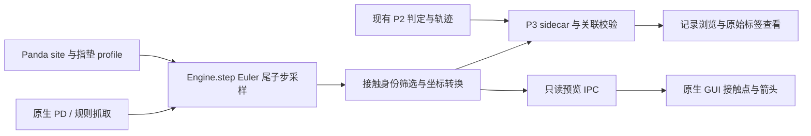

# RoboLab Studio P3 接触标签设计

设计日期：2026-11-03。接续更新：2026-11-04，A 批原生采样和坐标转换已实现并验收，见 [P3_A_REPORT.md](../../P3_A_REPORT.md)。下文保留原设计决策；B 批持久化合同及 C 批 GUI 尚待实现。

## 1 当前范围和目标

当前 WSL 工作树基于 `3f86aa013956b8a4724d0d6d02225a842f09553d`，含已验收但未提交的 P2 第二批修改。P3 首批复用 LIBERO-Object 任务 0、Panda 关节 PD 与规则抓取，先获得可核验的当前时刻指垫接触标签。

目标：在保持现有物理控制的前提下，记录谁与谁接触、接触位置、法向及力，明确采样时刻和夹爪参考系；能够通过数值测试、实际抓取和原生 GUI 核验。P3 标签先服务数据质量与仿真诊断，后续 P4 再建立训练数据。

现有模型适配器保持独立；真实 FER/D455/夹爪尚未接入。笔记本承担轻量开发，不下载模型、不训练、不调整现有依赖或第三方源码。

## 2 基于现有代码的设计决定

| 决定 | 内容及原因 | 状态 |
| --- | --- | --- |
| D1 参考系 | G 使用 `gripper0_grip_site`，保存实际 site 名称与 `T_world_gripper`；它是仿真参考系，真实 TCP 另行标定 | A 批已在实际模型绑定并校验 |
| D2 指垫定义 | `gripper0_finger1_pad_collision` / `gripper0_finger2_pad_collision` 定义模拟指垫；其他手指碰撞体另分类 | A 批实际空间核验和诊断图通过 |
| D3 原始采样 | 首版只对原生 `Engine.step()` 的 Euler PD 路径提供原始求解器标签 | A 批已实现，运行时检查配置；Mock/OFT 原始来源暂不支持 |
| D4 时间标签 | 默认每 20 ms 控制周期保留最后一个物理子步的求解器样本，明确求解器输入时刻及积分结束时刻 | A 批真实引擎 1100 个样本时序核验通过 |
| D5 数据格式 | P2 v1/v2 保持原语义，新增带版本的 P3 sidecar 文件；不为旧记录补造标签 | 合同草案与例子已生成 |
| D6 指标独立 | 原 P2 成功标准保持；P3 原始接触、约束激活、承载状态分别记录 | A 批已实现，P2 开／关对照一致 |
| D7 模型边界 | 保存模型无关物理量与相机标定；π₀.₅ 状态／动作转换交给未来 Adapter | 设计约束 |

`FingerContactProbe.read()` 当前只检查双指与目标的布尔接触。它的子树映射可复用，但不能把所有手指表面接触都称为指尖／指垫接触，也不改变其原有 P2 判定。

原生规则抓取经过 `Engine.step()`；Mock/OFT 通过 `LiberoRuntime.action()` 在另一套环境中执行，并将状态复制回来后 `mj_forward`。首版对这条策略执行路径返回“原始接触标签暂不支持”，不把复制后重算的力标为原始动作执行力。后续要支持它，需在真实执行环境内部增加采样钩子，独立验收。

## 3 接触语义与几何映射

### 3.1 保存和分类

采样读取实际 `data.contact`，保留包含已注册手指几何体的接触。几何 ID 仅对本次模型有效，必须同时保存名称和模型 XML 哈希。接触索引只在单帧内有效，不作为跨帧追踪 ID。

分类：`finger_target`、`finger_environment`、`finger_distractor`、`finger_robot_other`、`finger_unknown`。通过目标刚体子树识别目标，手掌／桌面／其他物体不能混为目标接触。无关场景接触不逐条保存，但记录全场景接触数量和筛选数量。

表面区域为 `pad`、`other_finger`、`unknown`。指垫身份由本次模型的显式几何 profile 给出。碰撞掩码不是身份判据：模型中某些 geom 的 `contype=0`，仍要结合实际接触、`conaffinity` 及显式碰撞对判断，不能只用 `contype` 删除合法接触。

### 3.2 接触点不是精确指尖材料点

MuJoCo 接触位置是几何体间的求解器中点，`distance_m` 为最近点间距，负值表示穿透。字段明确标为 `position_role=solver_midpoint`。P3 不把该点声称为高精度指腹表面测量；后续部位标签若需表面投影，另行定义方法、误差和版本。[接触结构说明](https://mujoco.readthedocs.io/en/2.3.7/APIreference/APItypes.html#mjcontact)

### 3.3 约束与承载分开

- `constraint_active = (efc_address >= 0 and exclude == 0)`，保存原始 exclude / address。
- `distance_m <= 0` 可用于判断几何穿透，不代替约束激活和承载状态。
- `load_bearing = constraint_active and normal_force_N > force_epsilon_N`。草案默认 epsilon 为 `1e-6 N`，只用于数值零附近的区分；不得替代稳定夹持／任务成功阈值。参数写入元数据。
- 接触候选在 margin/gap 内可能不进入求解器。已用独立场景观察到 dist=0.007 m、exclude=1、efc_address=-1、力为零的情况，必须如实保存。

原始点全部保留，不通过平滑或平均掩盖短时接触。P3 的 50 Hz 采样可能漏掉更短事件，数据说明必须注明；全物理步采样为后续独立模式，不在首版暗中增加。

## 4 坐标与力的约定

`T_WG` 表示从夹爪 G 到世界 W 的变换，采用列向量：`p_W = R_WG p_G + t_WG`。矩阵按 4×4 行数组保存；长度 m、角度 rad、力 N，原始 wrench 后三项为 N m。

```text
p_G = R_WGᵀ (p_W - t_WG)
n_G = R_WGᵀ n_W
F_G = R_WGᵀ F_W
```

MuJoCo 的接触 frame 按行存储世界中的接触轴，第一行为法向。`mj_contactForce()` 返回接触坐标系中的六维 wrench。设计采用 `F_W_on_geom2 = Cᵀ F_contact`，据实际几何顺序统一转换为“作用在另一接触体上的力”。法向统一为“从手指指向另一接触体”。[力接口说明](https://mujoco.readthedocs.io/en/2.3.7/APIreference/APIfunctions.html#mj-contactforce)

当 finger=geom1、other=geom2 时取正；当 finger=geom2、other=geom1 时反号。独立球体承重实验已在两种 geom 顺序下得到对上方 1 kg 球体约 `[0,0,9.81] N` 的力。实际 Panda 仍须检查夹爪转动和左右指方向。

保留原始六维 wrench 以供审计，但首版只导出转换后的力向量；不把接触点力矩直接称为夹爪原点力矩。后者需要含力臂项的完整 wrench 变换，留作扩展。

## 5 采样时序和非侵入性

现有 `Engine.step(.02)` 通常进行 10 次 2 ms 子步。`mj_step` 先计算动力学再积分，因此返回时新的 qpos 与已缓存的几何／接触可能不在同一阶段。[官方步进流程](https://mujoco.readthedocs.io/en/2.3.7/programming/simulation.html#simulation-loop)

首版维持原 `robot.apply_control(dt) → mj_step()` 调用顺序。在控制周期最后一个子步：

1. 应用控制后，保存该子步输入的 time/qpos/qvel/ctrl。
2. 正常调用现有 `mj_step`，不切换积分器，不额外在实时 data 上 forward。
3. 在下一次步进和其他计算前，复制本次求解器接触、力、site 及相机变换，按输入时刻标记；与第 1 步快照交叉核验。
4. 生成不可变采样结果，供 P3 文件和 GUI 使用。P2 原轨迹继续按原有逻辑保存，两个时间字段不混用。

例：控制周期结束在 `0.020 s`，其尾子步求解器输入为 `0.018 s`；P3 行同时保存 `solver_step_start_time_s=0.018` 和 `state_after_step_time_s=0.020`。P2 对应的轨迹行索引为 1；P2 初始行 0 不生成伪造的 P3 求解器标签。

运行时仅接受已验证的 Euler 与 `na=0` 当前 Panda 路径。其他积分器／执行器或内部执行路径返回能力不支持，不自动修改模型选项，也不根据 time-dt 猜测任意积分器的内部阶段。

首版还要求显式 PD 控制且没有未经审计的全局控制回调；若回调在 `mj_step` 内部改写控制输入，必须单独确定其实际采样点，不能沿用步前 ctrl 快照。

暂停不会产生新物理标签；单步恰好增加一个控制尾子步样本。编辑、重置、切换任务后旧预览立即标为失效。尚未步进显示“尚未采样”，不以零力表示未知。

对当前正常 22 s / 1101 行 P2 episode，目标是 1100 个 P3 样本：跳过 P2 初始行，结束检查不重复采样。若开始后立即取消、物理尚未推进，则 P3 可以正常关闭但有 0 样本；这与“已采样且没有接触”的空 contacts 行不同。

读取／可视化需要额外 forward 时，只在独立 data 副本上进行，并标记结果为重建。MuJoCo 2.3.7 本地 Python 未暴露 `mj_copyData` 函数；设计探针已验证 `copy.copy(data)` 可用于独立副本检查。复制／重建也不能将结果变成原始步进力。

非侵入性验收比较采样开启／关闭的控制命令、步数、最终 qpos、执行器边界和 P2 判定。以同一初态结果最大 qpos 差 ≤`1e-9` 为初始回归门槛；异常须保留而不是调环境凑结果。

## 6 数据合同与兼容

首版新增文件：

```text
episode/
  metadata.json                 现有 P2 v2，原判定
  trajectory.jsonl              现有 P2 状态轨迹
  model.xml                     现有状态查看模型
  p3_contact_metadata.json      新 P3 manifest
  p3_contacts.jsonl             新 P3 采样记录
```

持久化帧合同为 `robolab.p3_contact_frame.v1`，来自 A 批内存帧 `robolab.p3_contact_sample.v1`，仅替换 schema 标识。结构见 [JSON Schema](contact-frame.schema.json)，应用使用标准库读取与校验。原设计示例仍标记为 `record_origin=design_example`，使用独立的示例 schema 标识，正式读取会拒绝。

| 数据组 | 保存内容 |
| --- | --- |
| 关联 | episode_id、P3 sample_index、p2_trajectory_row_index、profile_sha256 |
| 来源与时间 | native_euler_step、control_tail_substep、solver 输入／积分后时间、dt |
| 参考状态 | reference_site、T_WG、求解器输入 qpos/qvel/ctrl；维度由 manifest 指定 |
| 相机 | agentview / robot0_eye_in_hand 的 K、T_WC、224×224 对应分辨率和 OpenCV 约定，标记 calibration_only |
| 接触 | geom ID／名称、手指、对象类别、指垫类别、原始 contact frame／wrench、两坐标系下的位置／法向／力、dist 与有效性标记 |
| 数据能力 | original_rgb_recorded=false；接触列表允许为空 |

P3 第一版不保存 RGB。相机标定对应其明示的图像尺寸，但不凭此声称存在同步图像或可训练数据。P4 需要单独增加同步 RGB、图像处理链、部位标签及可选模拟深度。

manifest schema 为 `robolab.p3_contact_episode.v1`。它保存采样器与帧合同标识、模型维度 nq/nv/nu、MuJoCo 版本、原生 dt、指垫 profile 与哈希、force_epsilon 及采样器／转换／写入源码 SHA256。正式结束后记录 sample_count、首末求解器时间、P3 轨迹 SHA256 和 `parent`。父关联包含 P2 schema、轨迹 SHA256、模型 XML SHA256、样本数与执行结果。父文件最终完成后才原子替换 P3 manifest。P2 标记本次预期生成附属记录，供识别文件意外缺失。

P3 `recording_status` 为 recording / finalized / failed；正常关闭的取消或失败 episode 仍可有完整的 P3 标签，P2 `episode_status` 独立为 cancelled / failed / succeeded。写入错误应暂停并报告，未最终关闭的文件保持不完整，不能静默继续并声称完整采集。

P2 原有五类结果保持。P3 状态区分“已校验／未采集／格式不支持／不完整／损坏／写入失败”。旧 v1/v2 没有 sidecar 属于未采集。P3 校验结果独立显示，P2 原始结果和状态查看继续由父记录决定。缺少结束哈希或截断属于不完整；哈希、维度、父轨迹关联错误属于损坏。

读者检查有限值、数组维度、约束标记、递增时间、dt、父子索引及 SHA256。A 批在采样端检验矩阵正交、法向、坐标往返和力方向。每个非初始 P2 行都有一个样本，初始行无接触样本。P3 的 solver 时间对应积分前状态，积分后时间用于匹配父行。立即取消可产生 0 帧的完整记录，正常步进后无接触用空列表表示。

## 7 模块和 GUI 方案



拟新增 `contact_geometry.py`（纯数值转换）、`p3_contact.py`（MuJoCo 采样／profile）、`p3_recording.py`（sidecar）、`contact_store.py`（读取与校验）、`contact_panel.py`（Qt）。改动钩子限于 engine、规则记录生命周期、worker、GUI、语言目录及独立验收脚本；VLA 合同和规则动作流程不重写。

GUI 使用现有 PySide6 和后端主线程渲染，提供接触点、法向／力箭头、夹爪坐标轴，左右指／目标／环境筛选、单位和明确采样时间。力箭头可缩放，数值保持原单位；绘制数量截断须提示，磁盘原始记录不因 UI 限制截断。

预览与落盘分开：手动原生 PD 可只读预览，不伪造 episode ID；持久化合同仅用于 P2 episode 中已关联的行。预览 IPC 另用状态信封表示未采样、失效和不支持，不用空接触代替这些状态。预览节流以现有渲染／通信频率为上限，落盘采样频率不由 GUI 刷新率决定。

回看时接触点必须配合原始 `state_at_solver`。P2 v2 的积分后 qpos 不能无提示叠加上一子步的接触；界面切换到“接触采样状态”时明确显示其时间。为绘图重建的接触力不覆盖 sidecar，成功结果始终读取原始执行记录。

中英切换只翻译界面；稳定标识符、数值、原始任务指令和文件内容不变。所有新增异常和状态需有语言模板。

## 8 与论文方法及后续研究的关系

G³VLA 的多相机 ray / PRoPE / 融合位于视觉通路，训练监督可来自模拟几何真值或离线 π³X，部署时去掉辅助头；它没有直接实现本项目的夹爪接触头。π₀.₅ 保留连续动作生成，实际状态、动作空间及归一化在未来 Adapter 中核对。

P3 的当前接触真值不直接等于“未来会在哪里接触”的训练目标。P4／模型设计时固定预测时域和参考时刻，例如将 `t+h` 的接触点转换到观测时刻 `G_t`，同时记录动作条件与 mask。只用当前已夹住的图像训练当前接触预测，不能据此宣称实现抓取规划。

力先用于标签核验和稳定性分析，是否加入力预测由后续消融决定。目标／障碍标签不包含语言指定部位；后者由 P4 参数化物体与部位定义提供。训练可用仿真深度作监督，真实相机输入仍按双 RGB。

实验顺序为 π₀.₅ 基线 → 相机几何单独增量／接触单独增量 → 两者结合；候选评分另作开关。对象留出、视点留出、语言部位命中、稳定抓取与碰撞分别报告，保持可比较数据与训练预算。

## 9 设计核查和待验证事项

本轮已经做：只读核对现有代码和保存 XML；两种 geom 排序的承重力方向检查；非激活 margin 候选检查；步后时序与独立副本检查；合同草案的有效／空样例及错误反例校验。详见 `design-audit.json`、`contract-validation.json`。

2026-11-04 更新：Panda 实际步进采样、指垫诊断图、开启采样后的基线对照及相关 A 批边界回归已完成。sidecar 生命周期、原生 GUI 和扩展场景回归仍按 B／C 批实施；详情以 A 批报告为准。

2026-11-10 更新：B 批正式记录与旧格式兼容已实测，见 [P3 B 批报告](../../P3_B_REPORT.md)。C 批接入同步采样状态的接触显示和扩展初态验证。

2026-11-10 C 批验收：实时和历史采用独立求解器输入姿态，增加桌面／腕部视角与半透明近景，默认汤罐四个官方初态通过。证据和 P4 后续范围见 [P3 C 批报告](../../P3_C_REPORT.md)。

原设计轮仅做文档与探针；接续 A 批已修改只读采样钩子并做实际抓取对照。原先 WSL 改动保留，Windows 源码副本不自动同步。后续按 `P3_IMPLEMENTATION_PLAN.md` 分批实现。

## 10 参考

- MuJoCo 2.3.7 [mjContact](https://mujoco.readthedocs.io/en/2.3.7/APIreference/APItypes.html#mjcontact)、[mj_contactForce](https://mujoco.readthedocs.io/en/2.3.7/APIreference/APIfunctions.html#mj-contactforce)、[Simulation loop](https://mujoco.readthedocs.io/en/2.3.7/programming/simulation.html#simulation-loop)。
- 用户提供的 `2606.24472v2 G3VLA.pdf`：方法第 3–4 页；`2504.16054v1 π0.5.pdf`：模型与技术附录第 5、19 页。详细阅读依据见随附 `G3VLA_PI05_READING_NOTES.md`。
